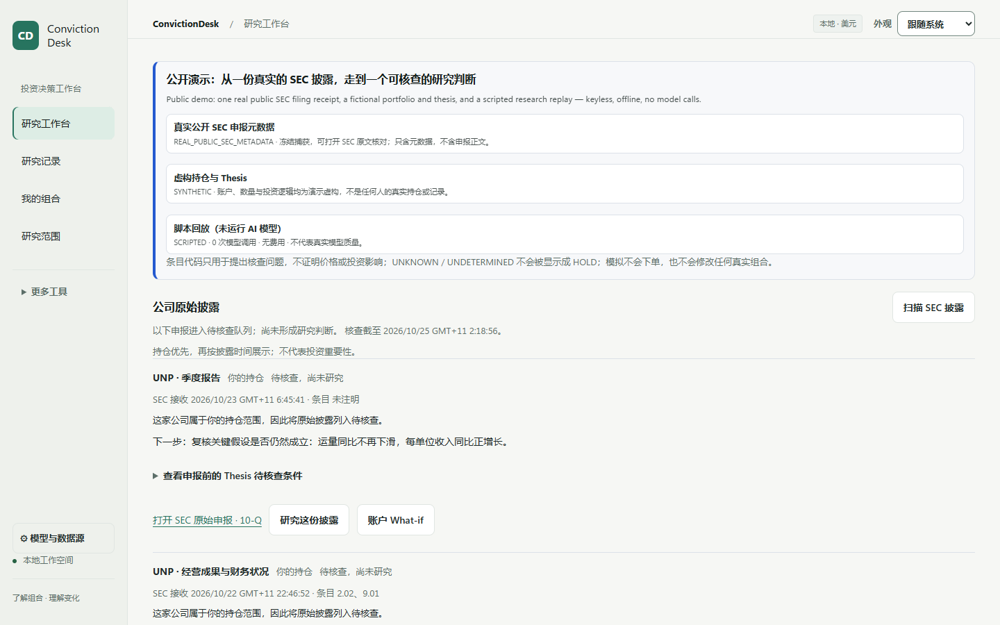
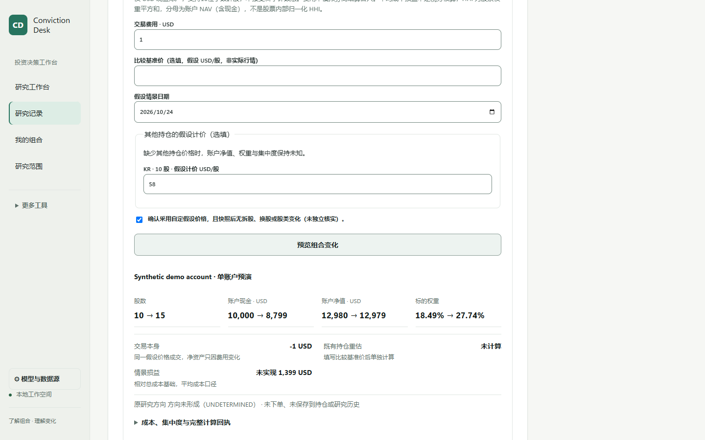

# ConvictionDesk · v0.10.0 limited beta

**Follow one public SEC filing from a fictional holding to an auditable research
record and a hypothetical account change — without an API key.**

The interface is primarily Simplified Chinese, with an English first-screen gloss.
This is a local, offline demonstration of the actual research workbench.

| What you see | Provenance |
| --- | --- |
| SEC accession, form, accepted/captured UTC and original URL | Real public metadata, frozen on 2026-10-24; no filing body |
| Account, holdings, price marks and prior Thesis | Fictional, labelled SYNTHETIC |
| Fast and Deep research text | SCRIPTED replay; no AI model invoked, no model fee |

## Quickstart

Python3.12 or later. Dependency installation may use the internet; running the
keyless demo does not contact model, news or market-data providers.

**Windows — PowerShell**

```powershell
git clone https://github.com/Ernesto12139/ConvictionDesk.git
cd ConvictionDesk
python -m venv .venv
.venv\Scripts\python.exe -m pip install .
.venv\Scripts\python.exe -m market_agent.public_ivs --serve
```

**Linux / macOS**

```bash
git clone https://github.com/Ernesto12139/ConvictionDesk.git
cd ConvictionDesk
python3 -m venv .venv
.venv/bin/python -m pip install .
.venv/bin/python -m market_agent.public_ivs --serve
```

Open **http://127.0.0.1:8791/**. The synthetic SQLite state is created in
`./.public-ivs`; choose a fresh path with `--root <path>`, or another loopback
port with `--port 8899`. An unmarked existing database is refused. Port8000 is
reserved and refused by this demo. Keep the local service on loopback.

## Try the journey

1. Read the three provenance labels and the populated SEC disclosure lane.
2. Expand **查看申报前的 Thesis 待核查条件**. DOW deliberately has no prior Thesis.
   The original SEC link is available; opening it explicitly uses your browser's
   internet connection.
3. Choose **研究这份披露 → 开始研究 → 确认开始研究**. Read the scripted Fast
   result, cited evidence, counterevidence and what remains unknown.
4. Choose **继续为 Deep · 保留同一条记录**, then confirm. This creates revision2
   on the same task; revision1 stays available through **历史版本**.
5. In the result card's **账户 What-if**, enter5 shares at240. Expand
   **费用、其他持仓计价与资本假设**, enter fee1 and KR mark58, choose
   2026-10-24, attest the stated share-basis assumption, and preview.
   Fictional NAV is12980→12979; cash is10000→8799. Without KR's mark, NAV and
   weights stay unknown. This never places an order or changes saved holdings.

Filing item codes raise questions; they do not prove price causality or a changed
Thesis. Insufficient evidence remains **UNDETERMINED**, never automatic HOLD.
The demo does not claim a proven Thesis delta when no saved comparison exists.

## Screenshots

Captured from the public-IVS workbench; all financial scope is fictional.





## Reproduce the checks

```bash
.venv/bin/python -m market_agent.public_ivs --root /tmp/convictiondesk-journey --journey
.venv/bin/python -m pip install '.[test]'
.venv/bin/python -m pytest -o addopts='' --basetemp=/tmp/convictiondesk-unique-test-root tests/test_public_ivs_journey.py
python release/check_import_closure.py --source .
```

Use a fresh, exclusively owned external test directory on every run. On Windows
use `.venv\Scripts\python.exe` and a unique directory under `$env:TEMP`.
The executable journey prints exact Decimal results and revision/evidence identity.
Public CI also exercises Linux/Windows, no-network runtime, the actual browser
result-card What-if, existing SEC time/authority negatives and history auditing.

## Other entrypoints and limitations

- `python -m market_agent.serve` retains the earlier **read-only fictional replay**
  at http://127.0.0.1:8080/. It does not start the new SEC-to-What-if journey.
- `python scripts/sec_evidence_demo.py` retains the standalone offline SEC metadata
  projection. Its source-time receipts and F1/F2 regression tests are preserved.
- Deep demonstrates revision/evidence mechanics with scripted text. It is not a
  claim of better model reasoning, live investment quality or verified returns.
- This public demo stores fictional research locally. It is not an authenticated
  shared service. Do not point it at a real portfolio or expose it publicly.
- Live provider configuration is separate: [data sources](docs/data-sources.md).
  Installing a key does not itself authorize paid dispatch or data transfer.

[Quickstart details](docs/getting-started.md) · [Architecture](docs/architecture.md) ·
[Verification](docs/verification.md) · [Changelog](CHANGELOG.md) ·
[Release notes](release/V010_RELEASE_NOTES.md) · [MIT license](LICENSE)
