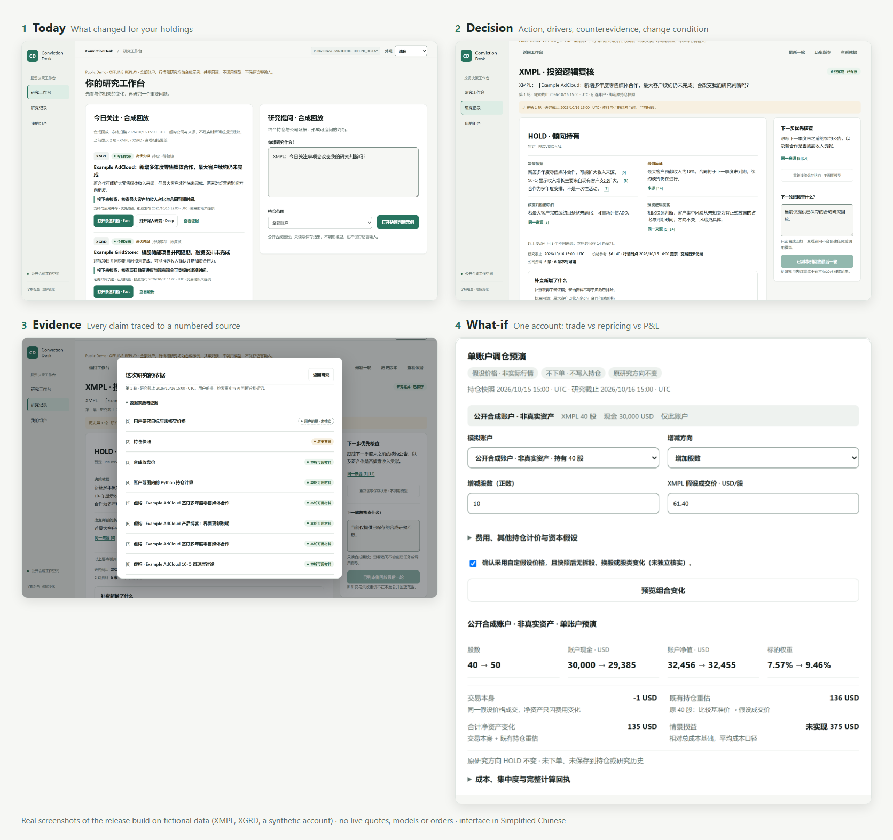
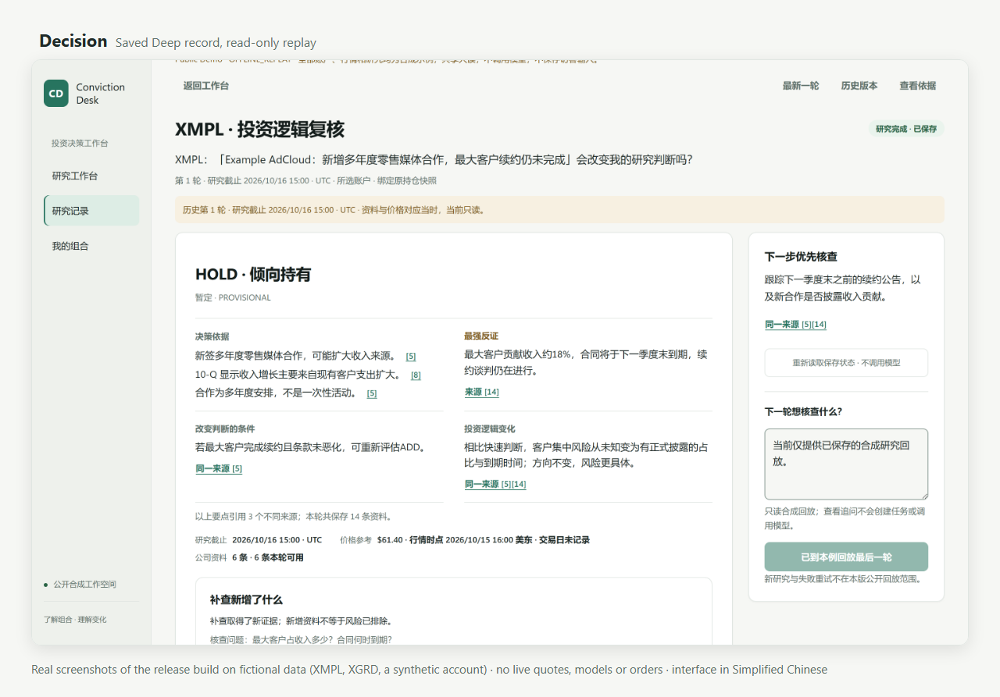
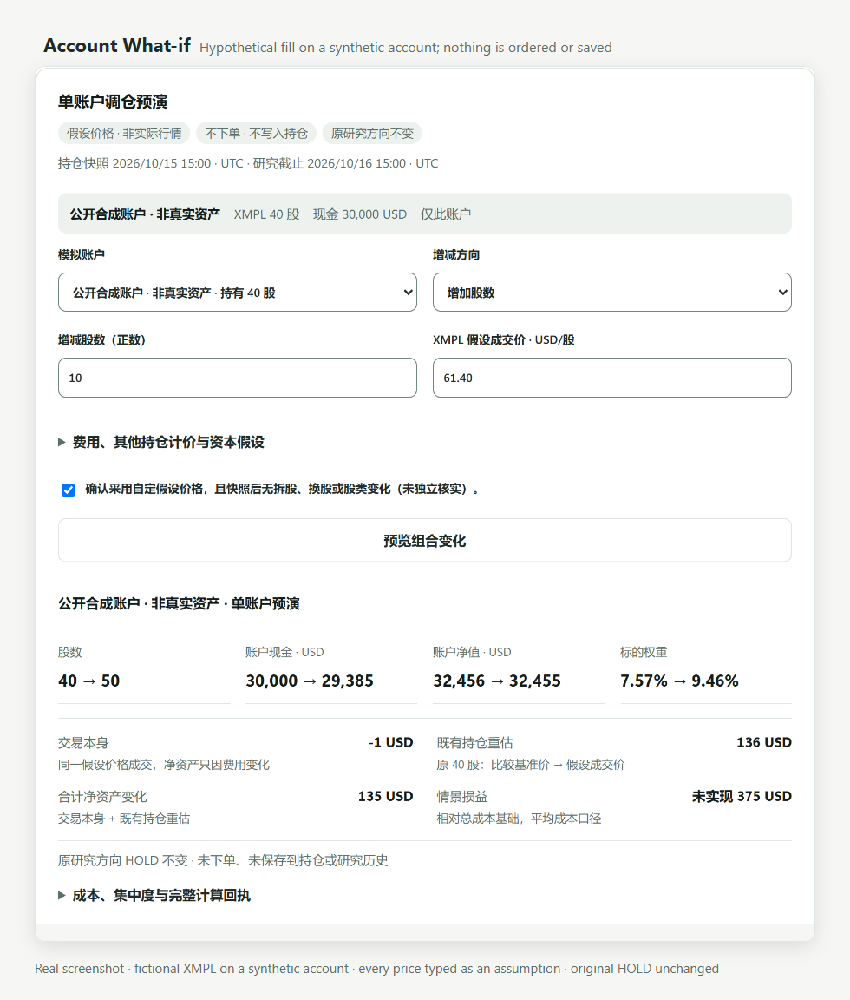
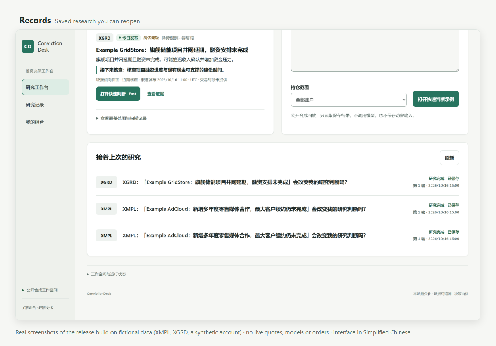
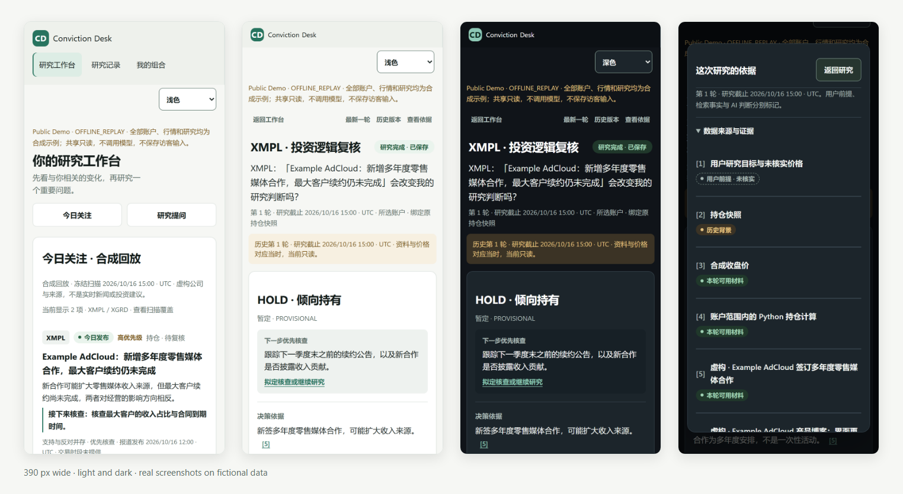
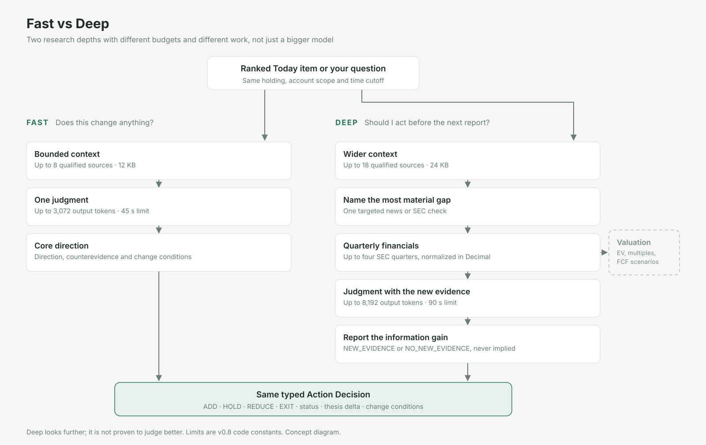

<h1 align="center">ConvictionDesk</h1>

<p align="center">
  <strong>Know what changed. Understand what matters. Decide what to do with your portfolio.</strong>
</p>

<p align="center">
  A local, open-source decision desk for people who hold or follow US stocks.<br>
  It ties each new event to the positions you hold and the reason you own them, then returns an evidence-cited <b>ADD · HOLD · REDUCE · EXIT</b> call, or says <b>UNDETERMINED</b>.
</p>

<p align="center">
  <a href="https://github.com/Ernesto12139/ConvictionDesk/actions/workflows/ci.yml"></a>
  
  <a href="LICENSE"></a>
</p>

<p align="center">
  <a href="#try-it-without-api-keys">Try it without API keys</a> ·
  <a href="#the-journey">The journey</a> ·
  <a href="#how-it-works">How it works</a> ·
  <a href="#run-it-on-your-own-portfolio">Live setup</a> ·
  <a href="#release-status">Release status</a>
</p>

<p align="center">
  <picture>
    <source media="(prefers-color-scheme: dark)" srcset="docs/assets/convictiondesk-journey-dark.png">
    
  </picture>
</p>
<p align="center"><sub>Real screenshots of the keyless replay that ships with this repository. Companies, filings, prices and accounts are fictional; judgments are scripted replay text, not live model output.</sub></p>

## What it answers

| Your question | What ConvictionDesk does |
|---|---|
| **What changed for my holdings?** | **Today** scans company news for your research universe, removes duplicates and stale stories, screens for materiality and ranks what is left. A scan that can't cover everything says **PARTIAL** and shows what it covered. |
| **Why does it matter, and what evidence counts?** | **Research** binds one event or question to a frozen snapshot of your holdings and account scope, then gathers typed evidence: portfolio, end-of-day price, company news, SEC filings and XBRL. |
| **Does it change my thesis?** | Each result carries a **thesis delta**: what this evidence changed about your reason to own, the strongest counterevidence, and what would change the call. |
| **Should I consider changing my position?** | A typed **Action**: `ADD` / `HOLD` / `REDUCE` / `EXIT` with status `SUPPORTED`, `PROVISIONAL`, `UNDETERMINED` or `NOT_APPLICABLE`. Thin evidence is `UNDETERMINED`, never a default HOLD. HOLD, REDUCE and EXIT require that you actually hold the stock. |
| **What would happen if I did?** | A saved Action opens a **single-account What-if**: explicit buy/sell shares, hypothetical fill and fees → cash, shares, NAV, weights and concentration. `Decimal` separates existing-share repricing from trade impact (fees). Missing marks stay unknown. No orders or saved holdings/research changes. |
| **Where should I watch price conditions?** | A synthetic OHLCV example demonstrates qualified daily SMA/ATR/range zones and invalidations with a reproducible receipt. Real provider OHLCV and technical quality remain **LIVE_DATA_NOT_VERIFIED**; these are not targets or automatic actions. |

## Try it without API keys

The packaged replay runs the full Today → Fast / Deep → Action → Evidence → Records journey on fictional data. It makes **no model or market-data calls**, ignores any keys in your environment and refuses every write. Python 3.12+ is required.

v0.9.0 adds the decision-first research page, account What-if and synthetic technical calculations. The shared keyless replay is read-only: it shows saved records but does **not** run What-if or technical calculations (the What-if screenshot below comes from a local copy of the same fictional data).

**macOS / Linux**

```bash
git clone https://github.com/Ernesto12139/ConvictionDesk.git
cd ConvictionDesk
python3 -m venv .venv && source .venv/bin/activate
pip install .
python -m market_agent.serve
```

**Windows (PowerShell)**

```powershell
git clone https://github.com/Ernesto12139/ConvictionDesk.git
cd ConvictionDesk
python -m venv .venv
.venv\Scripts\python.exe -m pip install .
.venv\Scripts\python.exe -m market_agent.serve
```

Open **http://127.0.0.1:8080/**, pick an item under *今日关注* (Today) and choose **Fast** or **Deep**. Then open *查看依据* (Evidence) and *研究记录* (Records).

- **Port 8080 taken?** Pick another: `PORT=8091 python -m market_agent.serve`, or `$env:PORT = "8091"` in PowerShell.
- **Network exposure.** The native preview listens on `127.0.0.1`. Docker explicitly uses `HOST=0.0.0.0` inside its container and publishes to localhost:
  `docker build -t convictiondesk . && docker run --rm -p 127.0.0.1:8080:8080 convictiondesk`
- The preview entrypoint refuses to start if your shell still has `MIA_RUNTIME_MODE=OWNER`; clear it first. If a previous dataset version is refused, point `MIA_DEMO_DIR` at a new folder.

## The journey

**1 · Today.** A manual, cost-confirmed scan of your universe. Each item shows why it matters, what to verify next and when it was published by New York calendar date. Older stories are never relabelled as today's.

**2 · Fast or Deep.** Fast answers *"does this change anything?"* within a tight budget. Deep answers *"should I act before the next report?"*: it names the most material evidence gap and runs **one** targeted news or SEC check. Deep can continue the **same** saved Fast task as its next round, so the record stays one line of reasoning.

**3 · Action and thesis delta.** The first screen answers in one place: direction and status, up to four distinct reasons, the strongest counterevidence, what would change the call and the thesis change. Each statement appears once; when several points rest on the same source, the page says so instead of counting it twice. The next check to run is spelled out, on a phone directly under the conclusion.

<p align="center">
  <picture>
    <source media="(prefers-color-scheme: dark)" srcset="docs/assets/convictiondesk-decision-dark.png">
    
  </picture>
</p>

**4 · Evidence.** Every material claim cites an evidence ID that must exist in the task. Sources are labelled as user premise, historical background or material available in that round, with publication time and type.

**5 · Account What-if.** Pick the account that holds the stock (its shares and cash show before you type), enter a hypothetical fill and see shares, cash, NAV and weight before → after. The trade itself (fees only), repricing of shares you already hold against an optional reference price, and modeled profit/loss are reported separately, in exact `Decimal`. Missing prices stay unknown; overselling is refused; nothing is ordered or saved and the original Action is unchanged.

<p align="center">
  <picture>
    <source media="(prefers-color-scheme: dark)" srcset="docs/assets/convictiondesk-whatif-dark.png">
    
  </picture>
</p>

**6 · Records.** Each result is an immutable, hash-checked revision. Reopen it when the next event arrives, compare rounds and see exactly what was known at the cutoff.

<p align="center">
  <picture>
    <source media="(prefers-color-scheme: dark)" srcset="docs/assets/convictiondesk-records-dark.png">
    
  </picture>
</p>

<details>
<summary>On a phone</summary>
<p align="center"></p>
</details>

## Why not just ask a chatbot?

A general assistant can write a fluent paragraph about any stock. ConvictionDesk is built so the answer is about *your* position, uses only what was known at the time and gets the numbers right.

| | One-off stock chat | ConvictionDesk |
|---|---|---|
| **Your positions** | Whatever you paste in | Bound to a frozen portfolio snapshot per task; position-dependent actions only for stocks you hold |
| **Time** | Can quietly use later information | A point-in-time cutoff per task; later sources are rejected before anything is saved |
| **Evidence** | Facts and opinion blended | Statements typed as fact, user assertion, AI draft or unknown; citations must resolve to evidence in the task |
| **Numbers** | Arithmetic done by the model | Portfolio, SEC-quarter and TTM math in Python `Decimal`; model output that introduces new numbers is rejected; missing values stay unknown, never zero |
| **Continuity** | Gone when the chat ends | Immutable revisions you can reopen, continue and audit |

## How it works

<p align="center">
  <picture>
    <source media="(prefers-color-scheme: dark)" srcset="docs/assets/convictiondesk-architecture-dark.svg">
    
  </picture>
</p>

One Python service (FastAPI, Pydantic v2, `httpx`, stdlib `sqlite3`) and a dependency-free HTML/CSS/JS console. No agent framework, vector database or queue. Models do bounded screening, planning and synthesis. They may cite only evidence that the typed tool pipeline supplied, and they never do authoritative arithmetic. Dashed boxes are planned work.

- **Point in time.** Publication time, retrieval time, financial period and price session are separate fields, checked against the task cutoff.
- **Deterministic finance.** SEC quarter / YTD normalization in `Decimal`, including derived Q4 flows. EPS is never derived by subtraction. Historical TTM revenue, net income and operating cash flow keep unit, currency, period, as-of time, source and status, and feed Deep as cited inputs.
- **Unknown stays unknown.** Capitalization, P/E, P/S and unaligned TTM EPS stay unknown without complete share-class and corporate-action qualification.
- **Immutable history.** Revisions are hash-checked in SQLite; schema upgrades keep the original bytes.

<p align="center">
  <picture>
    <source media="(prefers-color-scheme: dark)" srcset="docs/assets/convictiondesk-fast-deep-dark.svg">
    
  </picture>
</p>

| | **Fast** | **Deep** |
|---|---|---|
| Ask it | "Does this news change anything for me?" | "Should I act before the next report?" |
| Reads | Up to 8 qualified sources (12 KB) | Up to 18 qualified sources (24 KB), up to four SEC quarters and historical TTM |
| Extra work | None, one judgment | One targeted news or SEC check on the most material gap |
| Model budget | ≤ 3,072 output tokens, 45 s | ≤ 8,192 output tokens, 90 s |
| Returns | Typed Action Decision | The same, plus `NEW_EVIDENCE` or `NO_NEW_EVIDENCE` |

Deep looks further. It is not claimed to judge better, and when its check finds nothing new it says so.

## Run it on your own portfolio

Live research needs **four kinds of configuration**, because each part of the answer comes from a different source. A missing provider makes that part unavailable or unknown; it is never filled with synthetic facts.

| Powers | Provider | Variable | Cost and limits |
|---|---|---|---|
| Fast / Deep research, Today screening | OpenAI Responses, `gpt-6.1-sol` (server profiles `sol-fast`, `sol-deep`) | `OPENAI_API_KEY` | Pay-per-token on your account; model availability depends on your account |
| Company news for Today | [Finnhub](https://finnhub.io/) | `FINNHUB_API_KEY` | A free personal-use tier exists; check current limits and terms |
| End-of-day prices | [Massive](https://massive.com/pricing) | `MASSIVE_API_KEY` | Free *Stocks Basic*: end-of-day data, 5 calls/minute; paid tiers lift limits. Closing prices, not real-time quotes |
| Filings and XBRL | [SEC EDGAR](https://www.sec.gov/search-filings/edgar-search-assistance/accessing-edgar-data) | `SEC_USER_AGENT` | Free; requires your name and contact email; automated access capped at 10 requests/second |

Other OpenAI-compatible models (`LLM_PROVIDER`, `LLM_BASE_URL`, `LLM_API_KEY`, `LLM_MODEL`) run a single experimental research path **without** the Fast/Deep profiles.

```bash
# macOS / Linux
export MIA_RUNTIME_MODE=OWNER
export OPENAI_MODEL=gpt-6.1-sol
export OPENAI_API_KEY=...
export FINNHUB_API_KEY=...
export MASSIVE_API_KEY=...
export SEC_USER_AGENT="Your Name you@example.com"
python -m uvicorn market_agent.main:app --host 127.0.0.1 --port 8000
```

```powershell
# Windows PowerShell
$env:MIA_RUNTIME_MODE = "OWNER"
$env:OPENAI_MODEL = "gpt-6.1-sol"
$env:OPENAI_API_KEY = "..."
$env:FINNHUB_API_KEY = "..."
$env:MASSIVE_API_KEY = "..."
$env:SEC_USER_AGENT = "Your Name you@example.com"
.venv\Scripts\python.exe -m uvicorn market_agent.main:app --host 127.0.0.1 --port 8000
```

Open **http://127.0.0.1:8000/**, add your portfolio under *我的组合* (CSV import) or a watch list, then refresh Today. Every scan, new research, follow-up and Deep round shows a **cost confirmation first**; cancel sends nothing. A completed Fast task can continue as Deep in the same record. Saved Today receipts can be screened again in one confirmed batch without refetching news.

**Keys and data stay local.** Keys are read only from the server's environment (`.env` files are not loaded) and are never entered into or returned to the browser. Data lives in `data/market_agent.db` (`MIA_DB_PATH` moves it). The live service has **no authentication**, so keep it on `127.0.0.1`.

## Release status

v0.9.0 is a **limited beta**: each row states how far it is verified. Release notes: [`release/V09_RELEASE_NOTES.md`](release/V09_RELEASE_NOTES.md).

| Status | Capability |
|---|---|
| ✅ Verified (scoped) | Typed ADD / HOLD / REDUCE / EXIT with status, evidence strength, thesis delta, counterevidence, change conditions and holding applicability |
| ✅ Verified (scoped) | Fast / Deep budgets, context limits and tool permissions |
| ✅ Verified (scoped) | Evidence-ID and point-in-time validation: invalid citations and later sources are rejected |
| ✅ Verified (scoped) | SEC monetary quarter / YTD normalization in `Decimal`, derived Q4 flows; EPS never derived by subtraction |
| ✅ Verified (scoped) | Today states: complete, no material events, partial, provider unavailable; cost confirmation before live work |
| ✅ Verified (scoped) | Keyless synthetic replay: Today → Fast / Deep → Action → Evidence → Records, zero model and data calls |
| 🧩 Implemented, synthetic/frozen verification | Same-task Fast → Deep continuation |
| 🧩 Implemented, synthetic/frozen verification | Historical TTM in Deep's cited context and the research page; per-symbol Today coverage; current batch vs. older pending receipts |
| 🧩 Implemented, synthetic/frozen verification | Local price-scenario receipt from user-supplied dated prices; refuses known share-class or corporate-action conflicts; never updates the saved Action |
| 🧩 Implemented, synthetic verification; independent engineering QA accepted | Decision-first research page (one brief, same-source disclosure, mobile next step) and single-account share-delta What-if: holding-account default, fees, missing prices, cash/oversell/class guards, trade vs repricing vs modeled P&L, exact plain decimals |
| 🧩 Implemented, synthetic verification; independent engineering QA accepted | Regular-session OHLCV qualification → SMA20 / simple ATR14 / 10-session candidate bands → explicit hypothetical account preview; real data not admitted |
| 🧪 Experimental | Live Today scans, live research and CSV portfolio import with your own keys; other OpenAI-compatible models |

*Verified (scoped)* means covered by the deterministic and synthetic checks below, not universal live coverage. ConvictionDesk makes **no accuracy, return or backtest claim**; the quality of live screening and direction is not benchmarked.

**Known limits:** end-of-day prices only; a full watch-list Today scan can end PARTIAL under provider limits, and large saved queues can exceed one batch; no live adapter yet qualifies share classes and corporate actions, so live valuation multiples stay unknown; no broker integration or trade execution; interface in Simplified Chinese.

### Roadmap

Planned, not in this release:

- **Portfolio-wide changes and decision delta**: connect multiple accounts and events; single-account hypothetical fills are already implemented above.
- **Qualified live technical inputs**: licensed OHLCV, historical vintages, complete split/halt coverage; synthetic zones are not live signals.
- **Live valuation**: market cap, EV and multiples with qualified share data; Bull / Base / Bear scenarios.
- **Ownership signals**: 13F institutional holdings, Form 4 insider transactions.
- **Bring your own model**: cross-provider keys with Fast / Deep profiles.
- **English and Traditional Chinese interface.**

## Testing and CI

Every push and tag runs the [CI workflow](.github/workflows/ci.yml):

- the deterministic test suite on Ubuntu and Windows (decision contracts, citation and point-in-time rejection, `Decimal` finance, Today states, replay integrity);
- a keyless **HTTP journey** and a **Playwright browser journey** of the replay: all guest writes denied, zero model calls;
- a **read-only Docker preview** smoke test as a non-root user with all capabilities dropped;
- a **public-history audit** of authorship, refs and release identity.

```bash
pip install ".[test]"
python -m pytest -q
python -m market_agent.serve &        # keyless replay on :8080
python scripts/smoke_public_demo.py --base http://127.0.0.1:8080
```

These checks prove the pipeline behaves as specified. They are not evidence of investment performance.

## Releases and contributing

This repository is an independently initialized source release. Development happens in a private engineering repository; each release is an allowlisted export of one verified upstream commit, recorded in [`release/RELEASE_MANIFEST.json`](release/RELEASE_MANIFEST.json). Later releases extend the same public history. The project uses AI-assisted development; public commits and releases are maintained under the repository owner's identity.

Issues, bug reports and product feedback are welcome. Accepted changes are applied upstream and arrive in the next release.

| Version | Highlights |
|---|---|
| v0.9.0 (limited beta) | Decision-first research page, same-task Fast → Deep, historical TTM, dated price scenarios, account What-if, synthetic OHLCV zones, Today coverage and refreshed screenshots |
| v0.8.1 | Saved research opens completely; execution details behind *执行记录与诊断*; README and diagrams |

## License

[MIT](LICENSE) © 2026 Ernesto12139. The license covers this repository's code, the original diagrams in `docs/assets/` and the replay screenshots, which show only fictional data. Dependencies are installed from PyPI under their own licenses and none are vendored. Data from Finnhub, Massive, SEC EDGAR and model providers remains subject to their terms.

**ConvictionDesk is a research tool, not investment advice.**
