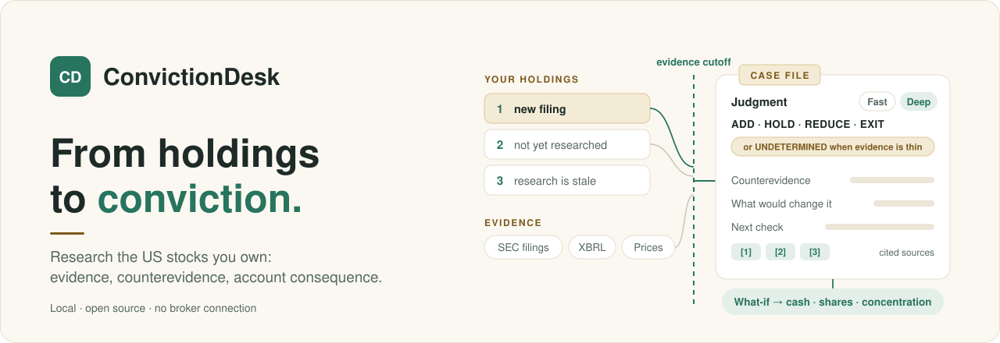
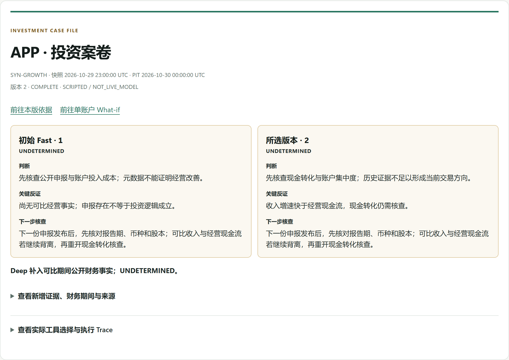

<p align="center">
  <picture>
    <source media="(prefers-color-scheme: dark)" srcset="docs/assets/convictiondesk-brand-hero-dark.svg">
    
  </picture>
</p>

<p align="center">
  <a href="https://github.com/Ernesto12139/ConvictionDesk/releases"></a>
  <a href="https://github.com/Ernesto12139/ConvictionDesk/actions/workflows/ci.yml"></a>
  <a href="LICENSE"></a>
  
</p>

<p align="center">
  <b>Investigate what changed in the US stocks you own, weigh the evidence against
  your thesis, and see what a change would do to the account that pays for it.</b><br>
  A local, open-source research workbench. No broker connection.
</p>

<p align="center">
  <a href="#try-it-in-30-seconds"><b>Try it in 30 seconds</b></a> ·
  <a href="#run-it">Run it</a> ·
  <a href="#how-it-works">How it works</a> ·
  <a href="#scope">Scope</a> ·
  <a href="docs/README.md">Docs</a>
</p>

## What it does

**Find a research starting point.** In the keyless portfolio-priority journey,
synthetic holdings are ordered by committed cost (`quantity × average cost`),
highest first, with symbol as the tie-breaker. Open a holding to examine captured
filings and its research history. The sample list is not a live news ranking;
live scans and quote references require the separate integrations described below.

**Investigate real evidence.** Ask about one holding. In the public journey,
Fast reads frozen filing metadata; Deep adds comparable-period SEC financial
facts to the same task. Each scripted round shows the
judgment, the strongest counterevidence, what would change it and the next
check, each linked to its source. Thin evidence stays `UNDETERMINED`; it is
never turned into a default hold.

Deep's Case File shows eight typed numeric receipts: four reported revenue and
operating cash flow values, two Decimal changes and two year-over-year
percentages, with exact periods and accessions. These use frozen, matching
six-month `PUBLIC_SEC` facts with `SYNTHETIC` accounts and `SCRIPTED` research;
the keyless journey makes no live data or model calls.

**Understand portfolio consequences.** Preview a hypothetical buy or sell on a
copy of one account and see cash, shares and concentration before and after.
Missing prices stay unknown instead of becoming zero. Nothing is ordered and
your saved holdings do not change.

<p align="center">
  <picture>
    <source media="(prefers-color-scheme: dark)" srcset="docs/assets/cd-case-proof-dark.png">
    
  </picture>
</p>
<p align="center"><sub>Real capture of the public build: one task after Fast, then Deep. Synthetic account, frozen public SEC filings, scripted research; the interface is in Chinese. <a href="release/ASSET_PROVENANCE.md">Asset provenance</a>.</sub></p>

## Try it in 30 seconds

After the native installation below, follow this short synthetic journey:

1. Open **组合研究优先级** (portfolio priority) and choose **APP**, then the Growth account.
2. Run **Fast**, then continue **Deep** on the same task. The Case File keeps both rounds side by side.
3. Follow **前往单账户 What-if** and enter five shares at $200. Open **费用、其他持仓计价与资本假设** to set a $1 fee, tick the price and no-split confirmation, then preview. Cash moves from $1,200 to $199; no order is placed. Missing prices still leave NAV or concentration unknown.

[The full walkthrough](docs/portfolio-priority-journey.md) lists every source and number.

## Run it

Python 3.12 or newer. No API keys.

```sh
# macOS / Linux
git clone https://github.com/Ernesto12139/ConvictionDesk.git && cd ConvictionDesk
python3 -m venv .venv && .venv/bin/python -m pip install .
.venv/bin/python -m market_agent.serve
```

```powershell
# Windows PowerShell
git clone https://github.com/Ernesto12139/ConvictionDesk.git; cd ConvictionDesk
python -m venv .venv; .venv\Scripts\python.exe -m pip install .
.venv\Scripts\python.exe -m market_agent.serve
```

Open <http://127.0.0.1:8080/>. Fast, Deep and the What-if use the native install above.
For a read-only container preview, run `docker build -t convictiondesk . && docker run --rm -p 127.0.0.1:8080:8080 convictiondesk`.
Packaged versions are on the [Releases page](https://github.com/Ernesto12139/ConvictionDesk/releases).

## How it works

Each question becomes a research task with a frozen scope. Typed tools gather
evidence, code checks the result, and the task saves an immutable revision.

<p align="center">
  <picture>
    <source media="(prefers-color-scheme: dark)" srcset="docs/assets/convictiondesk-task-loop-dark.svg">
    
  </picture>
</p>

- **Point in time.** A task binds one account snapshot to an evidence cutoff; later sources are rejected. [Context](src/market_agent/research_context.py)
- **Bounded, typed tools.** Read-only tools return evidence receipts within a fixed budget. Citations outside the task and unsupported numbers are rejected. [Research service](src/market_agent/research_task.py)
- **Financial meaning.** SEC facts keep accession, unit and exact period, so comparisons use matching periods. [Financial series](src/market_agent/financial_series.py)
- **Revisions and Trace.** Deep appends a revision; the first round is never rewritten. Each revision shows its own tool and model spans. [Trace](src/market_agent/research_execution_trace.py)
- **Account consequence.** Python `Decimal` computes the What-if on an isolated copy of one account, with cash and cross-account checks. [What-if](src/market_agent/portfolio_whatif.py)

[Architecture](docs/architecture.md) · [Verification, evals and guard commands](docs/verification.md) · [Data sources](docs/data-sources.md)

## Scope

| | Public Quickstart (no keys) | Separate experimental integrations |
|---|---|---|
| Holdings and prices | `SYNTHETIC` accounts and price marks; no current quotes | Local holdings; Massive close and Finnhub quote adapters require qualified provider access and rights |
| SEC filings | Real public filings, frozen capture with a 2026-10-30 cutoff | SEC EDGAR adapter requires your `SEC_USER_AGENT`; each filing keeps its accession and cutoff |
| Fast / Deep research | `SCRIPTED` replay; no model is called | OpenAI `gpt-6.1-sol` adapter; live execution requires current model/rate qualification, a task budget and server-side consent |
| What-if | Python `Decimal` on a copy of one account; nothing is ordered | Same |

The Quickstart enables none of these live integrations. A key alone is not a
complete live setup: current qualifications, source rights and budget gates
must also pass. This release verifies the keyless journeys; live data freshness
and model answer quality are not verified by public CI. See
[Getting started](docs/getting-started.md#live-mode-with-your-own-keys-experimental).
ConvictionDesk has no broker connection or order API, and it is not investment
advice. The server listens on loopback by default.

[Documentation](docs/README.md) · [Showcase](docs/showcase.md) · [Contributing](CONTRIBUTING.md) · [MIT license](LICENSE)


### Local candidate: five destinations and offline Agent boundaries

The proposed 0.16.0 increment gives the read-only replay five destinations: Today,
Market, Research, Portfolio, and Settings. Settings identifies SCRIPTED research;
Market explicitly reports UNAVAILABLE because the keyless package contains no
redistributable provider quotes or price history. The existing Portfolio Priority
journey, frozen SEC inputs, synthetic accounts and Decimal What-if remain separate
and unchanged. No visitor input starts a live model or provider request.

The source also includes opt-in offline building blocks for a typed Research /
Verifier boundary with one shared repair, append-only scoped memory and bounded
same-source SEC windows. Tests use synthetic evidence and scripted callbacks.
These blocks are not enabled in the default public replay and do not establish
live model quality, two-model independence, Jev-Mem benefit or fresh data retrieval.
Jev-Mem requires an optional separately obtained, hash-pinned upstream artifact;
this package never downloads one. A saved key does not activate live research.
