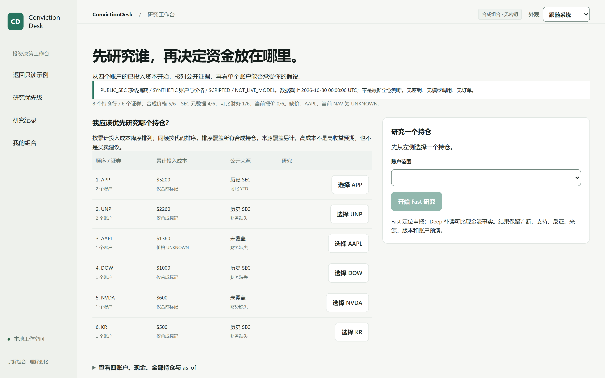
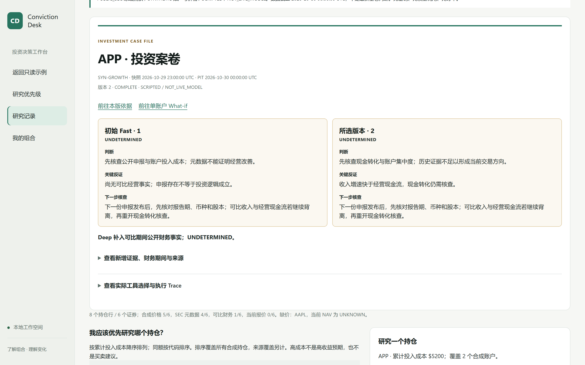
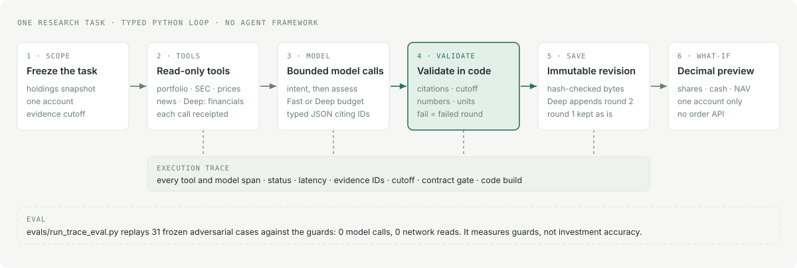

# ConvictionDesk — From holdings to conviction.

**Investigate what changed in the US stocks you own, weigh the evidence against
your thesis, and see what a change would do to the account that pays for it.**
A local, open-source research workbench. No broker connection.

<p align="center">
  <picture>
    <source media="(prefers-color-scheme: dark)" srcset="docs/assets/cd-priority-1440-dark.png">
    
  </picture>
</p>
<p align="center"><sub>Browser capture of the public workbench: synthetic accounts, frozen public SEC filings, scripted research. Capture IDs in <a href="release/ASSET_PROVENANCE.md">asset provenance</a>.</sub></p>

[Try it in 30 seconds](#try-it-in-30-seconds) · [Run it](#run-it) ·
[How it works](#how-it-works) · [Scope](#scope) ·
[Releases](https://github.com/Ernesto12139/ConvictionDesk/releases)

## What it does

**See what merits attention.** The home page lists your holdings in research order: new
filings or news, then positions you have never researched, then stale research,
then capital at stake. The daily scan says plainly whether it ran, found
nothing new, or could not reach its source, so an old list never passes as
today's news. Each quote carries its provider, market time and delay status.

**Investigate real evidence.** Ask about one holding. Fast reads the filing;
Deep adds comparable-period financials to the same task. Every round shows the
judgment, the strongest counterevidence, what would change it and the next
check, each linked to its source. Thin evidence stays `UNDETERMINED`; it is
never turned into a default hold.

**Understand portfolio consequences.** Preview a hypothetical buy or sell on a
copy of one account and see cash, shares and concentration before and after.
Missing prices stay unknown instead of becoming zero. Nothing is ordered and
your saved holdings do not change.

<p align="center">
  
</p>
<p align="center"><sub>The Case File after Fast and Deep on the same task. Both rounds stay readable.</sub></p>

## Try it in 30 seconds

1. Open **组合研究优先级** (portfolio priority) and choose **APP**, then the Growth account.
2. Run **Fast**, then continue **Deep** on the same task. The Case File keeps both rounds side by side.
3. Follow **前往单账户 What-if** and preview five shares at $200 with a $1 fee. Cash moves from $1,200 to $199; no order is placed.

[The full walkthrough](docs/portfolio-priority-journey.md) lists every source and number.

## Run it

Python 3.12 or newer. No API keys.

```sh
# macOS / Linux
git clone https://github.com/Ernesto12139/ConvictionDesk.git && cd ConvictionDesk
python3 -m venv .venv && .venv/bin/python -m pip install .
.venv/bin/python -m market_agent.serve
```

```powershell
# Windows PowerShell
git clone https://github.com/Ernesto12139/ConvictionDesk.git; cd ConvictionDesk
python -m venv .venv; .venv\Scripts\python.exe -m pip install .
.venv\Scripts\python.exe -m market_agent.serve
```

Open <http://127.0.0.1:8080/>. Or run `docker build -t convictiondesk . && docker run --rm -p 127.0.0.1:8080:8080 convictiondesk`.
Packaged versions are on the [Releases page](https://github.com/Ernesto12139/ConvictionDesk/releases).

## How it works

Each question becomes a research task with a frozen scope. Typed tools gather
evidence, code checks the result, and the task saves an immutable revision.

<p align="center">
  <picture>
    <source media="(prefers-color-scheme: dark)" srcset="docs/assets/convictiondesk-task-loop-dark.svg">
    
  </picture>
</p>

- **Point in time.** A task binds one account snapshot to an evidence cutoff; later sources are rejected. [Context](src/market_agent/research_context.py)
- **Bounded, typed tools.** Read-only tools return evidence receipts within a fixed budget. Citations outside the task and unsupported numbers are rejected. [Research service](src/market_agent/research_task.py)
- **Financial meaning.** SEC facts keep accession, unit and exact period, so comparisons use matching periods. [Financial series](src/market_agent/financial_series.py)
- **Revisions and Trace.** Deep appends a revision; the first round is never rewritten. Each revision shows its own tool and model spans. [Trace](src/market_agent/research_execution_trace.py)
- **Account consequence.** Python `Decimal` computes the What-if on an isolated copy of one account, with cash and cross-account checks. [What-if](src/market_agent/portfolio_whatif.py)

[Architecture](docs/architecture.md) · [Verification and guard commands](docs/verification.md) · [Data sources](docs/data-sources.md)

## Scope

The public build uses synthetic holdings and prices, frozen public SEC filings
and scripted research; it calls no model or market-data provider. Live quotes
need your own provider key and may be delayed. ConvictionDesk has no broker
connection or order API, and it is not investment advice. The server listens on
loopback by default.

[Documentation](docs/README.md) · [Showcase](docs/showcase.md) · [Contributing](CONTRIBUTING.md) · [MIT license](LICENSE)
