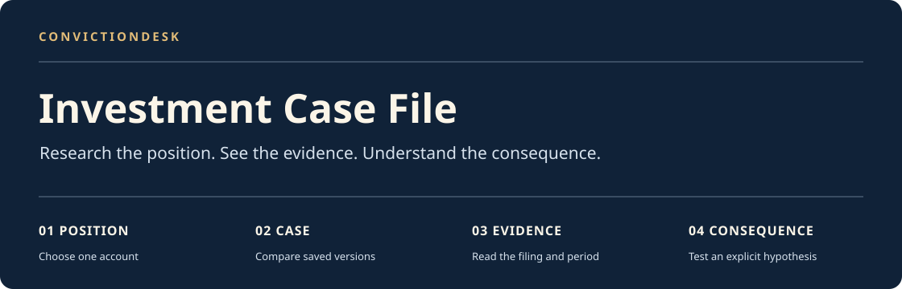
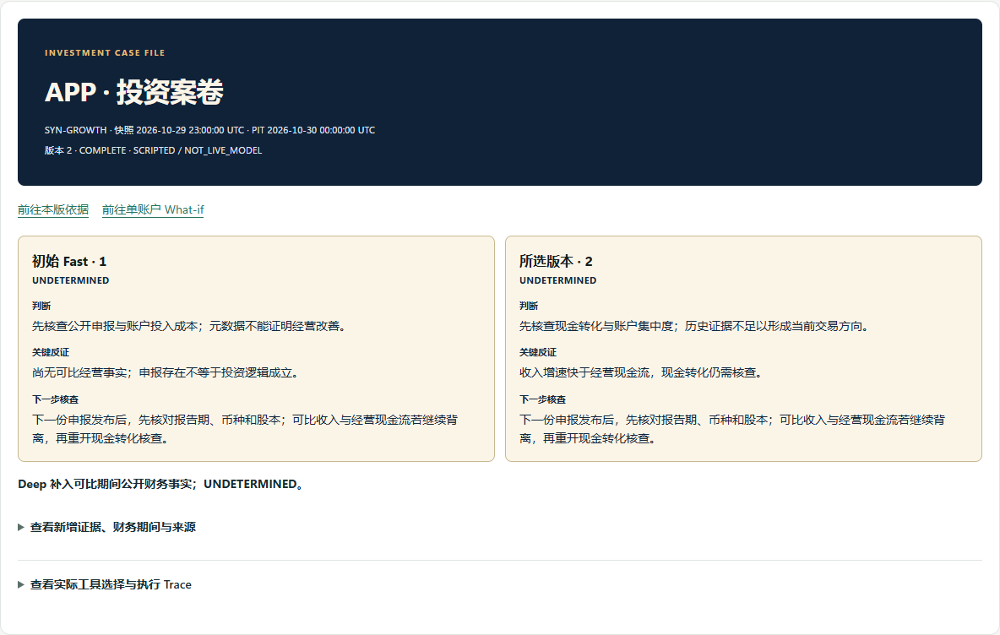

<p align="center">
  
</p>

**ConvictionDesk is a local investment research workbench for people who own US stocks.**
Start with a position and one account. Compare what you knew at the first pass with
what later evidence adds, then see how a hypothetical change would affect that account.



This Console capture uses a synthetic account and scripted research. PUBLIC_SEC
filings were accepted on 2026-08-05, with an evidence cutoff of 2026-10-30.
The desktop and mobile images are original 1× light-theme captures. [390 px mobile view](docs/assets/investment-case-390.png).

[Run it locally](#run-it-locally) · [Walk the case](#one-position-one-case-file) ·
[Under the hood](#under-the-hood) · [Releases](https://github.com/Ernesto12139/ConvictionDesk/releases)

## Why keep a case file?

If you manage positions across accounts, a new filing can add evidence without
changing your investment judgment. The workbench keeps the two versions together
so you can see which assumption, counterargument or next check changed. Before
acting, preview the cash and concentration effect on the account that would
actually fund the change.

The research queue ranks positions by committed cost and shows evidence coverage
separately. Missing quotes leave current NAV unknown.

## One position, one case file

1. **Position.** Open **组合研究优先级**, choose APP and select the synthetic
   Growth account. The account and snapshot date remain visible in the case.
2. **Case.** Save a Fast pass, then continue Deep on the same task. The case file
   above the saved reading pane shows both judgments, counterevidence and next checks.
   Both APP versions retain `UNDETERMINED`.
3. **Evidence.** Open the new evidence section to see the comparative revenue
   and operating cash flow periods from the filing. The case also links to the
   evidence reader and the selected revision's execution trace.
4. **Consequence.** Jump to the account What-if. Use five shares, an assumed
   $200 fill, a $1 fee and $240 for the other holding. Confirm the hypothetical
   price and share basis checkbox, then choose **预览组合变化**. The synthetic account
   preview moves cash from $1,200 to $199 and shares from 30 to 35. Reopen
   the first saved revision to see its evidence and trace again.

[Full portfolio journey and source details](docs/portfolio-priority-journey.md)

## Run it locally

Use Python 3.12 or newer. Installing downloads dependencies. The default public
workbench uses bundled evidence and scripted research without API keys.

**macOS / Linux**

```sh
git clone https://github.com/Ernesto12139/ConvictionDesk.git
cd ConvictionDesk
python3 -m venv .venv
.venv/bin/python -m pip install .
.venv/bin/python -m market_agent.serve
```

**Windows PowerShell**

```powershell
git clone https://github.com/Ernesto12139/ConvictionDesk.git
cd ConvictionDesk
python -m venv .venv
.venv\Scripts\python.exe -m pip install .
.venv\Scripts\python.exe -m market_agent.serve
```

Open [the local workbench](http://127.0.0.1:8080/) and choose **组合研究优先级**.
Version 0.13.0 adds the Investment Case File to the portfolio journey.
The commands above install the source checkout. For a published package and its
versioned assets, use the [GitHub Releases page](https://github.com/Ernesto12139/ConvictionDesk/releases).
Candidate reviewers should check out the exact reviewed commit before installation.

```sh
docker build -t convictiondesk .
docker run --rm -p 127.0.0.1:8080:8080 convictiondesk
```

## Under the hood

The research service freezes the task scope, collects bounded evidence, validates
the result and saves an immutable revision. Fast and Deep use the same typed
contracts. The public workbench exercises this loop with scripted responses.

<p align="center">
  <picture>
    <source media="(prefers-color-scheme: dark)" srcset="docs/assets/convictiondesk-task-loop-dark.svg">
    
  </picture>
</p>

- **Scope and point in time.** Bind one account and snapshot to an evidence cutoff.
  Sources published after that cutoff are rejected. [Context compiler](src/market_agent/research_context.py)
- **Tools and validation.** Typed read-only tools produce evidence receipts. Code
  rejects citations outside the task and unsupported numbers or units, and keeps
  verified facts distinct from attributed model drafts. [Research service and validation](src/market_agent/research_task.py)
- **Financial meaning.** Financial facts retain accession, currency and reporting
  period. Comparable periods feed deterministic calculations.
  [Financial series](src/market_agent/financial_series.py)
- **Memory and Trace.** Deep appends a revision while preserving the first round.
  The Case File reads saved versions and shows the selected revision's tool and
  model spans. [Journey](src/market_agent/portfolio_priority_journey.py) ·
  [Execution Trace](src/market_agent/research_execution_trace.py)
- **Account consequence.** Python Decimal computes cash, shares and concentration
  on a copy of one account. Cash limits and cross-account checks apply.
  [What-if engine](src/market_agent/portfolio_whatif.py)

To reproduce the guards, install test dependencies with the virtual environment's
Python (`python -m pip install ".[test]"`). Run the following from the repository
root, substituting `.venv/bin/python` or `.venv\Scripts\python.exe` for `python`
when the environment is not activated.

```sh
python -m pytest -q tests/test_portfolio_priority_journey.py
python evals/run_trace_eval.py
python evals/portfolio_priority_eval.py
```

These commands exercise the account/revision journey, the 31-case frozen guard
corpus, and the scripted HTTP research/What-if journey respectively. They make
zero paid model calls. Guard and arithmetic checks do not measure investment
accuracy. See the [verification scope](docs/verification.md) for platform gates.

## Trust and scope

The shipped public journey uses synthetic holdings and marks, frozen public SEC
evidence and a scripted model path. It requires no API key or live quote feed. ConvictionDesk has no broker
connection and no order API.
A What-if is arithmetic on a copy of one account and never places an order.
It is not investment advice and makes no accuracy or return claim.
The default native server listens on loopback.

[Documentation](docs/README.md) · [Contributing](CONTRIBUTING.md) · [MIT license](LICENSE)
