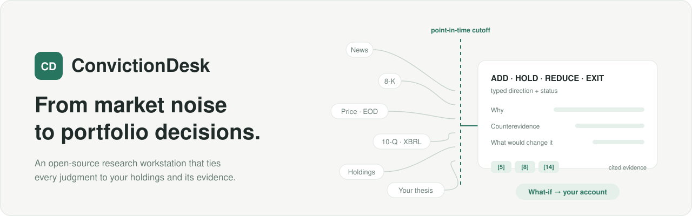

<p align="center">
  <picture>
    <source media="(prefers-color-scheme: dark)" srcset="docs/assets/convictiondesk-hero-dark.svg">
    
  </picture>
</p>

<p align="center">
  <a href="https://github.com/Ernesto12139/ConvictionDesk/actions/workflows/ci.yml"></a>
  <a href="release/V09_RELEASE_NOTES.md"></a>
  
  <a href="LICENSE"></a>
</p>

<p align="center">
  <a href="#quickstart">Quickstart</a> ·
  <a href="#how-it-works">How it works</a> ·
  <a href="docs/architecture.md">Architecture</a> ·
  <a href="docs/README.md">Docs</a> ·
  <a href="https://github.com/Ernesto12139/ConvictionDesk/releases">Releases</a>
</p>

**ConvictionDesk is an open-source research workstation for people who own US stocks.** It watches what changes around your holdings, investigates with evidence that existed at the time, and answers with a typed decision you can audit. Before you act, it shows what the trade would do to your account.

<p align="center">
  <picture>
    <source media="(prefers-color-scheme: dark)" srcset="docs/assets/convictiondesk-product-dark.png">
    
  </picture>
</p>
<p align="center"><sub>A saved Deep decision in the keyless replay that ships with this repository. The company and its filings are fictional; the interface is in Simplified Chinese.</sub></p>

## Why ConvictionDesk

A chatbot answers questions about stocks. ConvictionDesk answers a narrower, harder one: *given what I own, and what was knowable at that moment, does this change my decision?*

| | General stock chat | ConvictionDesk |
|---|---|---|
| **Context** | Whatever you paste in | A frozen snapshot of your holdings and account scope for every task |
| **Time** | May use later information | A point-in-time cutoff; later sources are rejected before anything is saved |
| **Evidence** | Facts and opinion blended | Every statement typed as verified fact, your assertion, AI draft or unknown, with citations that must resolve |
| **Numbers** | Arithmetic by the model | Portfolio, SEC-quarter and What-if math in Python `Decimal`; the model cannot introduce new figures |
| **Memory** | Gone when the chat ends | Immutable, hash-checked revisions you can reopen when the next event arrives |

## Discover, investigate, decide

### Discover — what changed for my holdings

**Today** (今日关注) scans company news across your research universe, drops duplicates and stale stories, screens each event for materiality and ranks what is left. Every item says why it matters and what to verify next. A scan that cannot cover everything reports *partial* and shows what it covered.

### Investigate — Fast or Deep, on one evidence trail

**Fast** answers *"does this change anything?"* from up to 8 qualified sources. **Deep** reads up to 18, adds SEC quarters and trailing-twelve-month figures in `Decimal`, and may spend one targeted news or SEC search on the most material gap it finds. A Fast result can continue as Deep in the same record, so the reasoning stays in one line.

### Decide — a typed answer, and its cost to your account

Each result is an **Action** — `ADD`, `HOLD`, `REDUCE` or `EXIT` — with a status and evidence strength.

- It carries the strongest counterevidence, the conditions that would change the call, and the thesis delta.
- Thin evidence is `UNDETERMINED`, never a default HOLD. `HOLD`, `REDUCE` and `EXIT` apply only to stocks you actually hold.
- From a saved Action, the **account What-if** turns a hypothetical fill into shares, cash, NAV, weight and concentration before and after, separating the trade itself from repricing of shares you already own. Nothing is ordered.

## Quickstart

The bundled replay runs the whole journey — Today → Fast / Deep → Action → Evidence → Records — on fictional data, with no API keys and no model or market-data calls. Python 3.12+:

```bash
git clone https://github.com/Ernesto12139/ConvictionDesk.git
cd ConvictionDesk
python3 -m venv .venv && source .venv/bin/activate
pip install .
python -m market_agent.serve
```

Open **http://127.0.0.1:8080/**, pick an item under *今日关注* (Today), choose **Fast** or **Deep**, then open *查看依据* (Evidence) and *研究记录* (Records).

<details>
<summary>Windows, Docker and port options</summary>

```powershell
git clone https://github.com/Ernesto12139/ConvictionDesk.git
cd ConvictionDesk
python -m venv .venv
.venv\Scripts\python.exe -m pip install .
.venv\Scripts\python.exe -m market_agent.serve
```

```bash
docker build -t convictiondesk . && docker run --rm -p 127.0.0.1:8080:8080 convictiondesk
```

Port 8080 taken? Set `PORT=8091` (PowerShell: `$env:PORT = "8091"`). More in [Getting started](docs/getting-started.md#troubleshooting).
</details>

**Your own portfolio.** Live mode connects four sources — a model, company news, end-of-day prices and SEC EDGAR — with keys that stay on your machine. Every scan and research run asks for cost confirmation first. Setup takes a few minutes: [Use your own portfolio →](docs/getting-started.md#use-your-own-portfolio)

## How it works

<p align="center">
  <picture>
    <source media="(prefers-color-scheme: dark)" srcset="docs/assets/convictiondesk-loop-dark.svg">
    
  </picture>
</p>

ConvictionDesk is one Python service (FastAPI, Pydantic v2, `httpx`, stdlib `sqlite3`) with a dependency-free HTML/CSS/JS console. There is no agent framework, vector store or queue: the research loop is plain, typed Python. Models screen, plan and synthesize inside fixed budgets; code owns the tools, the arithmetic and the final say on what may be saved.

- **Portfolio-aware by construction.** Each task binds a frozen portfolio snapshot and account scope. Position-dependent actions require a position you actually hold.
- **Point-in-time evidence.** Publication time, retrieval time, financial period and price session are separate fields, checked against the task cutoff before a source can be cited.
- **Deterministic financial receipts.** SEC quarter and year-to-date normalization, derived Q4 flows, trailing-twelve-month figures and the account What-if run in `Decimal`. A missing price stays unknown, never zero.
- **Validated output.** Every material claim must cite evidence in the task. Answers that invent a number, change a unit, upgrade an assumption into a fact or prescribe share quantities are rejected, not saved.
- **Saved revisions.** Research is stored as immutable, hash-checked revisions; follow-ups append, schema upgrades keep the original bytes.
- **Read-only MCP.** An optional [Model Context Protocol](https://modelcontextprotocol.io/) client fetches a market reference over JSON-RPC, allowlists read tools and refuses everything else before the network.
- **Reproducible evaluation.** A scripted oracle and the keyless replay drive HTTP and Playwright journeys in CI, so behavior is tested end to end without keys or network.

### Read the code

| Concern | Start here |
|---|---|
| Research loop, validators, saved revisions | [`research_task.py`](src/market_agent/research_task.py) |
| Bounded model context | [`research_context.py`](src/market_agent/research_context.py) |
| Typed Action and its checks | [`action_decision.py`](src/market_agent/action_decision.py) |
| Account What-if in `Decimal` | [`portfolio_whatif.py`](src/market_agent/portfolio_whatif.py) |
| SEC filings, XBRL and quarters | [`sec.py`](src/market_agent/sec.py), [`financial_series.py`](src/market_agent/financial_series.py) |
| Today screening and ranking | [`attention.py`](src/market_agent/attention.py) |
| Read-only MCP client | [`longbridge_mcp.py`](src/market_agent/longbridge_mcp.py) |
| Evaluation harness and replay | [`evals/`](evals/), [`tests/`](tests/), [`scripts/smoke_public_demo.py`](scripts/smoke_public_demo.py) |

A longer walkthrough, with diagrams of every layer, is in [Architecture](docs/architecture.md).

## Documentation

| Guide | What is inside |
|---|---|
| [Getting started](docs/getting-started.md) | Keyless replay, live setup with your own keys, troubleshooting |
| [Architecture](docs/architecture.md) | Layers, the research loop, Fast and Deep, point-in-time and `Decimal` design |
| [Data sources and keys](docs/data-sources.md) | Providers, costs, usage terms and where your keys and data live |
| [Verification](docs/verification.md) | What each capability is verified against, CI gates and known limits |
| [Showcase](docs/showcase.md) | Screens of the full journey, desktop and mobile |
| [Design notes](docs/README.md#design-notes) | Account What-if, Today candidate events, dated valuation and more |

## Project status

**v0.9.0 is a limited beta.** The decision engine, validators, `Decimal` finance and the keyless journey are covered by deterministic tests and browser journeys on every commit. Live mode with your own keys is experimental: the quality of live screening and decisions has not been benchmarked, and ConvictionDesk makes no accuracy or return claims. The interface is in Simplified Chinese. Details: [Verification](docs/verification.md) and the [v0.9.0 release notes](release/V09_RELEASE_NOTES.md).

**Next:** portfolio-wide change tracking across accounts, qualified live technical and valuation inputs, ownership signals from 13F and Form 4, bring-your-own-model profiles, and an English interface.

## Contributing

Issues, bug reports and product feedback are welcome — see [CONTRIBUTING.md](CONTRIBUTING.md). Development happens in a private engineering repository; each public release is an allowlisted export of one verified commit, recorded in [`release/RELEASE_MANIFEST.json`](release/RELEASE_MANIFEST.json), so accepted changes arrive with the next release. See the [Changelog](CHANGELOG.md) for what changed.

## License

[MIT](LICENSE) © 2026 Ernesto12139. Covers the code, the original diagrams in `docs/assets/` and the replay screenshots, which show only fictional data. Data from news, price, SEC and model providers remains subject to their own terms.

**ConvictionDesk is a research tool, not investment advice.**
