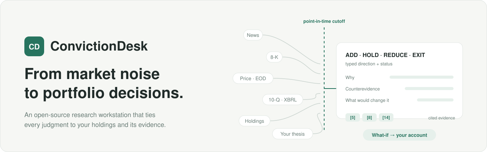
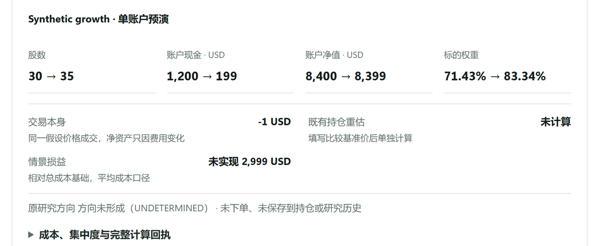
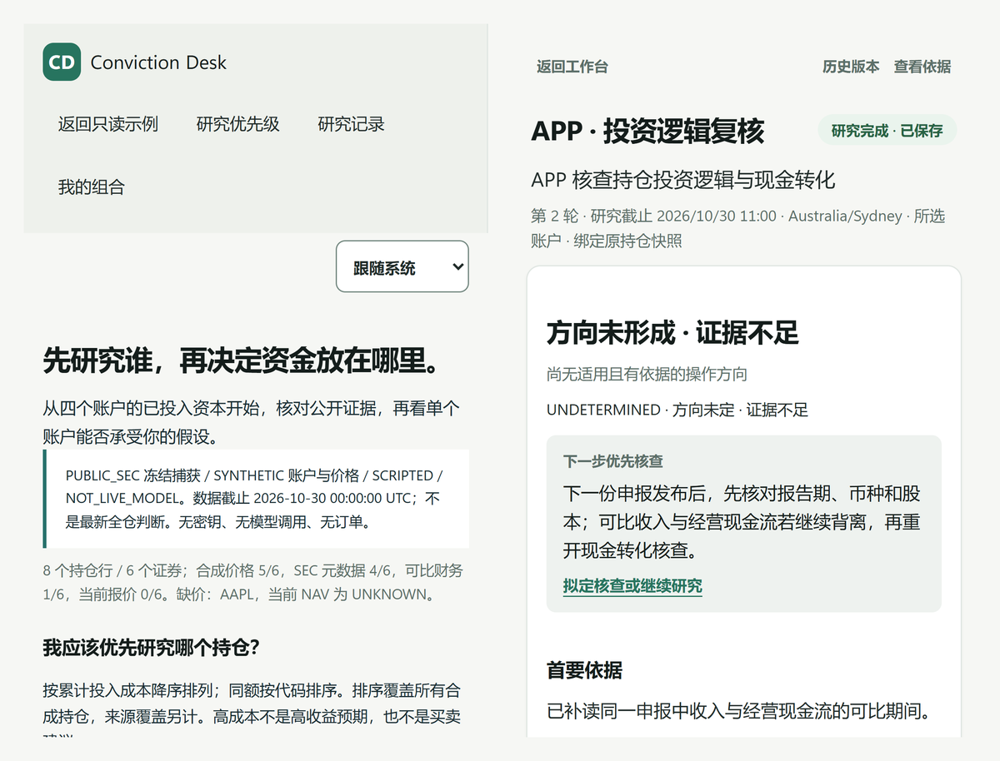

<p align="center">
  <picture>
    <source media="(prefers-color-scheme: dark)" srcset="docs/assets/convictiondesk-hero-dark.svg">
    
  </picture>
</p>

<h3 align="center">Know what changed. Understand what matters. Decide with conviction.</h3>

<p align="center">
  <a href="https://github.com/Ernesto12139/ConvictionDesk/releases/latest"></a>
  <a href="https://github.com/Ernesto12139/ConvictionDesk/actions/workflows/ci.yml"></a>
  <a href="LICENSE"></a>
  
  
</p>

<p align="center">
  <a href="#run-it-in-two-minutes"><b>Run it locally</b></a> ·
  <a href="#one-decision-end-to-end">The journey</a> ·
  <a href="#what-is-verified-and-what-is-not">What is verified</a> ·
  <a href="#how-it-works">How it works</a> ·
  <a href="docs/README.md">Docs</a>
</p>

**ConvictionDesk is an open-source, local research and decision workbench for people
who own US stocks.** It starts from your portfolio, not from a chat box. It tells you
which holding to look at first, researches it with evidence that existed at the time,
and shows what a hypothetical trade would do to one account. It never places an order.

## The problem it solves

If you hold a handful of US stocks across a few accounts, the hard part is not
finding information. The hard part is answering three questions honestly:

1. **Where should my attention go first?** Usually where the most capital is
   committed, not where the loudest headline is.
2. **Does this change my reason for owning it?** The answer has to rest on filings
   and facts that were public at that moment, and admit when the evidence is thin.
3. **What would acting do to my account?** The answer should be the same cash,
   shares and weights a broker would show, computed exactly, without a trade.

A general chat assistant answers fluently whether or not it has your context, the
right date or correct arithmetic. ConvictionDesk is built the other way round:

| | General stock chat | ConvictionDesk |
|---|---|---|
| **Starting point** | Whatever you paste in | Your accounts, frozen for each research task |
| **Time** | May mix in later information | A point-in-time cutoff; later sources cannot be cited |
| **Evidence** | Facts and opinion blended | Every claim cites a source ID; the strongest counterevidence is shown |
| **The answer** | Always confident | `ADD`, `HOLD`, `REDUCE`, `EXIT`, or `UNDETERMINED` when the case is not made |
| **Numbers** | Arithmetic by the model | Python `Decimal`; an unknown price stays unknown, never zero |
| **History** | Overwritten by the next reply | Immutable revisions; a deeper round never rewrites the first |

## Run it in two minutes

No account, no API key and no sign-in. Installing downloads Python dependencies;
running the workbench makes **no model or market-data request**. It binds to
`127.0.0.1` only.

**macOS / Linux**

```bash
git clone https://github.com/Ernesto12139/ConvictionDesk.git
cd ConvictionDesk
python3 -m venv .venv
.venv/bin/python -m pip install .
.venv/bin/python -m market_agent.serve
```

**Windows (PowerShell)**

```powershell
git clone https://github.com/Ernesto12139/ConvictionDesk.git
cd ConvictionDesk
python -m venv .venv
.venv\Scripts\python.exe -m pip install .
.venv\Scripts\python.exe -m market_agent.serve
```

Open **http://127.0.0.1:8080/** and choose **组合研究优先级** (portfolio research
priority) in the navigation. Port busy? Set `PORT=8091`. Other entry points, the wheel from
[Releases](https://github.com/Ernesto12139/ConvictionDesk/releases/latest), Docker
and troubleshooting: [Getting started](docs/getting-started.md).

> **What you are looking at.** SEC filing metadata and financial facts are real,
> frozen public captures (`PUBLIC_SEC`). The four accounts, their cash and marks
> are invented (`SYNTHETIC`). The research prose is a fixed script (`SCRIPTED` /
> `NOT_LIVE_MODEL`), not a language model. Every screen says so. Nothing here is
> anyone's real portfolio.

## One decision, end to end

The interface is in Simplified Chinese; bold labels below are the buttons you click.
Every screenshot is the real keyless workbench at 1440 px, captured from this
release with external requests blocked.

### 1 · Start from capital, not headlines

<p align="center">
  
</p>

Six synthetic holdings across four accounts are ranked by **committed cost**
(shares × average cost), largest first. Source coverage is shown beside the rank,
not mixed into it: which names have SEC metadata, which have comparable financials,
and that **no** name has a current quote. A high rank means "most money at stake",
not "best idea".

### 2 · Fast, then Deep on the same record

Pick **选择 APP** (select APP), choose the account explicitly, and **开始 Fast 研究**
(start Fast research). Fast locates the filing and returns a first judgment. Then
**继续同一 Task 的 Deep** (continue the same task in Deep) reads APP's comparable
January–June revenue and operating cash flow from the same 10-Q and adds round 2.

<p align="center">
  <picture>
    <source media="(prefers-color-scheme: dark)" srcset="docs/assets/convictiondesk-v012-record-dark.png">
    
  </picture>
</p>

Python `Decimal` derives revenue +55.77% and operating cash flow +34.70% for
January–June 2026 against 2025, both from accession `0001751008-26-000059`. The
judgment is **UNDETERMINED**: revenue outgrew cash flow, there is no confirmed
prior thesis and no current price. ConvictionDesk does not turn missing evidence
into a default HOLD. **历史版本** (version history) shows round 1 exactly as saved.

### 3 · See the account consequence, exactly

In the record's What-if, enter 5 more shares at a hypothetical USD 200, a USD 1 fee,
a mark for the account's other holding, and confirm the price assumption.

<p align="center">
  <picture>
    <source media="(prefers-color-scheme: dark)" srcset="docs/assets/convictiondesk-v012-whatif-dark.png">
    
  </picture>
</p>

Cash 1,200 → 199, shares 30 → 35, account value 8,400 → 8,399: the trade itself
only costs the fee. Seven shares would be **refused**, because this account cannot
spend another account's cash. No order is created and no snapshot changes.

### 4 · Check the receipts

**查看依据** (view evidence) lists each source with its accession, acceptance time,
capture time and the cutoff it was checked against. **查看实际工具选择与执行 Trace**
(view actual tool selection and execution Trace) shows every tool and model step of
each round with its status, evidence IDs, the cutoff, the final contract gate and the
build that ran it; the record also keeps each tool's arguments. Restart the server and
the record, its rounds and its Trace are still there.

<p align="center">
  
</p>
<p align="center"><sub>The same screens at 390 px.</sub></p>

## What is verified, and what is not

`PLANNED != IMPLEMENTED != VERIFIED`. "Verified" below means covered by the
deterministic test suite and the keyless HTTP and browser journeys that run in CI
on every push, on Linux and Windows. It never means live investment quality.

| Status | Capability | Where to check |
|---|---|---|
| **VERIFIED** | Portfolio priority by committed cost across four accounts, with source coverage kept separate and missing quotes / NAV shown as `UNKNOWN` | `evals/portfolio_priority_eval.py` |
| **VERIFIED** | Same-task Fast → Deep revisions; saved rounds are hash-checked and never rewritten | `tests/`, browser journeys |
| **VERIFIED** | Citations must point to evidence in the task; sources after the cutoff are rejected; invented numbers and unit changes are rejected before saving | `evals/run_trace_eval.py` (31 cases) |
| **VERIFIED** | SEC period facts and comparisons in `Decimal`, with accession, period and unit kept | `tests/` |
| **VERIFIED** | Single-account What-if in `Decimal`: fees, cash limit, oversell and cross-account refusal | `tests/`, browser journeys |
| **VERIFIED** | Per-task execution Trace with the code build that produced it | browser journeys |
| **VERIFIED** | Sample and preview workspaces cannot read each other's records; order and generic dispatch endpoints return `403` | `evals/portfolio_priority_eval.py` |
| **SCRIPTED** | The research judgments and prose in the keyless workbench: a fixed oracle, 0 model calls, no cost | the label on every screen |
| **EXPERIMENTAL** | Live SEC and news reads, Today scans and research with your own model keys. Works, not benchmarked; quality and cost are yours to judge | [Getting started](docs/getting-started.md) |
| **PLANNED** | 13F institutional and Form 4 insider changes; live market cap, EV and multiples; bull / base / bear scenario engine; English and Traditional Chinese interface | [Architecture](docs/architecture.md) |

**Not claimed anywhere:** investment accuracy, returns, backtests, real-time quotes,
broker connectivity, or that any real person's portfolio was used.

## How it works

One Python service (FastAPI, Pydantic v2, stdlib `sqlite3`) and a dependency-free
HTML/CSS/JS console. There is no agent framework, vector database or queue. The
research loop is plain, typed Python: code owns the order of steps, tools are typed
and read-only, the model makes bounded, typed decisions, and code has the last word
on what may be saved.

<p align="center">
  <picture>
    <source media="(prefers-color-scheme: dark)" srcset="docs/assets/convictiondesk-task-loop-dark.svg">
    
  </picture>
</p>

- **Tool calling, constrained.** The model never chooses arbitrary tools. Each
  step calls a typed, read-only tool whose arguments, status and output evidence
  IDs are recorded. Deep may run one extra targeted search for the most material
  gap, and must say whether it found new evidence.
- **Evidence and point in time.** Publication, SEC acceptance, retrieval and price
  times are separate fields, checked against the task cutoff. A source from after
  the cutoff is rejected at the tool boundary, before it can be cited.
- **Validated output.** An answer that cites missing evidence, invents a number,
  changes a unit or upgrades an assumption into a fact is rejected, not saved.
- **Deterministic finance.** SEC period normalization, portfolio math and the
  What-if run in `Decimal`. Missing prices stay unknown.
- **Trace and eval.** Every task keeps its execution Trace. A frozen 31-case
  corpus replays the guards offline; it measures whether guards fire, not whether
  a call was right.

| Concern | Start here |
|---|---|
| Research loop, validators, revisions | [`research_task.py`](src/market_agent/research_task.py) |
| Typed Action and its checks | [`action_decision.py`](src/market_agent/action_decision.py) |
| Portfolio priority journey | [`portfolio_priority_journey.py`](src/market_agent/portfolio_priority_journey.py) |
| SEC filings and the thesis before them | [`sec_filings.py`](src/market_agent/sec_filings.py), [`sec_thesis_delta.py`](src/market_agent/sec_thesis_delta.py) |
| Account What-if in `Decimal` | [`portfolio_whatif.py`](src/market_agent/portfolio_whatif.py) |
| Execution Trace | [`research_execution_trace.py`](src/market_agent/research_execution_trace.py), [`workbench_trace.py`](src/market_agent/workbench_trace.py) |

More in [Architecture](docs/architecture.md) and [Verification](docs/verification.md).

### Check it yourself

```bash
pip install ".[test]"
python -m pytest -q                      # deterministic suite, no network
python evals/run_trace_eval.py           # 31 frozen guard cases, 0 model calls
python evals/portfolio_priority_eval.py  # the journey above over HTTP
```

## Privacy, permissions and safety

- **Local and single-user.** No login and no hosted service. Keep it on
  `127.0.0.1`; it is not built to be exposed to a network.
- **Keyless by default.** The demo needs no key and sends nothing to a model or
  market-data provider. CI runs the browser journeys with every external request
  blocked.
- **Separate workspaces.** The sample journey uses its own synthetic state. It
  cannot open or import a personal portfolio database.
- **Your keys stay yours.** Live mode with your own keys is optional and
  experimental. Keep keys in your environment or a local `.env`, never in the
  repository; the sample never reads them.
- **No trading.** There is no broker connection and no order API. Order endpoints
  are refused. A What-if is arithmetic on a copy of one account.
- **Not investment advice.** ConvictionDesk makes no accuracy or return claim.
  `UNDETERMINED` is a frequent and intended answer.

## Open source

MIT licensed. Issues, bug reports and product feedback are welcome; see
[Contributing](CONTRIBUTING.md).

[Getting started](docs/getting-started.md) · [Portfolio priority journey](docs/portfolio-priority-journey.md) ·
[Architecture](docs/architecture.md) · [Data sources](docs/data-sources.md) ·
[Verification](docs/verification.md) · [Changelog](CHANGELOG.md) ·
[Releases](https://github.com/Ernesto12139/ConvictionDesk/releases) · [License](LICENSE)
