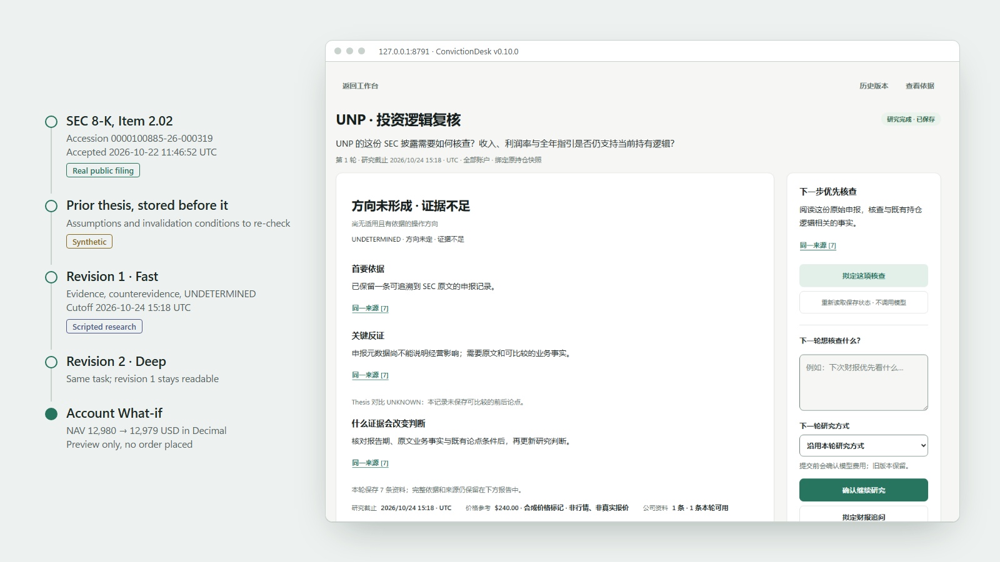

<p align="center">
  <picture>
    <source media="(prefers-color-scheme: dark)" srcset="docs/assets/convictiondesk-hero-dark.svg">
    
  </picture>
</p>

<h3 align="center">Know what changed. Understand what matters. Decide with conviction.</h3>

<p align="center">
  <a href="https://github.com/Ernesto12139/ConvictionDesk/releases/tag/v0.10.0"></a>
  <a href="https://github.com/Ernesto12139/ConvictionDesk/actions/workflows/ci.yml"></a>
  <a href="LICENSE"></a>
  
</p>

<p align="center">
  <a href="#get-started"><b>Run it locally</b></a> ·
  <a href="#one-decision-end-to-end">See the journey</a> ·
  <a href="#under-the-hood">Under the hood</a> ·
  <a href="docs/README.md">Docs</a>
</p>

**ConvictionDesk is an open-source research and decision workbench for people who
own US stocks.** It watches what changes around your holdings, checks it against
the reason you own them, researches with evidence that existed at the time, and
shows what a trade would do to your account before you make it.

## Why ConvictionDesk

A chatbot answers questions about stocks. ConvictionDesk answers a narrower,
harder one: *given what I own, and what was knowable at that moment, does this
change my decision?*

| | General stock chat | ConvictionDesk |
|---|---|---|
| **Context** | Whatever you paste in | Your holdings and account, frozen for each research task |
| **Time** | May mix in later information | A point-in-time cutoff; later sources cannot be cited |
| **Your thesis** | Forgotten between chats | The version you held *before* the event, kept with every round |
| **Evidence** | Facts and opinion blended | Every claim cites a source; the strongest counterevidence is shown |
| **The answer** | Always confident | `ADD`, `HOLD`, `REDUCE`, `EXIT`, or `UNDETERMINED` when the case is not made |
| **Numbers** | Arithmetic by the model | Portfolio and What-if math in Python `Decimal`; unknown stays unknown |

## What it does

| | Capability | In the keyless v0.10.0 workbench | With your own keys (experimental) |
|---|---|---|---|
| **Know what changed** | SEC filings for your holdings, with accession, items and acceptance time verified against SEC's clock | Real public filings, frozen capture | Live EDGAR reads |
| | Today: ranked company news with why it matters and what to verify next | — | Live news screening |
| **Understand what matters** | The prior thesis in force before an event, or an honest "none" | Synthetic thesis | Your saved theses |
| | Fast or Deep research with evidence, counterevidence and change conditions | Scripted research | Your chosen model |
| | Deep: SEC quarters and trailing-twelve-month figures in `Decimal`, one targeted follow-up search | — | Live |
| **Decide with conviction** | A typed Action, `UNDETERMINED` when evidence is thin | Yes | Yes |
| | Same-task Fast → Deep revisions; saved rounds never overwritten | Yes | Yes |
| | Single-account What-if: shares, cash, NAV and weight before and after | Yes | Yes |

The keyless workbench runs end to end with no key and no model or market-data
call. Live mode is in the code and works with your providers, but its answer
quality has not been benchmarked.

## One decision, end to end

<p align="center">
  <picture>
    <source media="(prefers-color-scheme: dark)" srcset="docs/assets/convictiondesk-hero-v010-dark.png">
    
  </picture>
</p>
<p align="center"><sub>A real record from the v0.10.0 workbench, beside the receipts behind it. Interface in Simplified Chinese.</sub></p>

1. **Know what changed.** The workbench opens on recent SEC filings for your
   holdings and watch list, each with why it is there and what to check first.
2. **Check the thesis.** **查看申报前的 Thesis 待核查条件** shows the thesis on record
   before the filing. A name without one says so.
3. **Research it.** **研究这份披露 → 开始研究 → 确认开始研究** returns the evidence,
   the strongest counterevidence and what would change the call. **查看依据** lists
   every source with its time and type.
4. **Go deeper without starting over.** **继续为 Deep · 保留同一条记录** adds a second
   round to the same record; **历史版本** keeps the first exactly as it was.
5. **See the account consequence.** The What-if on the result turns a hypothetical
   trade into shares, cash, NAV and weight before and after. A price it does not
   have stays unknown, never zero. Nothing is ordered.

In the keyless workbench the SEC filings for UNP, KR and DOW are real public
metadata captured on 2026-10-24; the account, thesis and prices are `SYNTHETIC`;
Fast and Deep are `SCRIPTED`. The page labels all three wherever they appear.
A guided click path with exact values is in [Getting started](docs/getting-started.md).

## Get started

Python 3.12 or later. Installing downloads dependencies; running the workbench needs no key.

**macOS / Linux**

```bash
git clone https://github.com/Ernesto12139/ConvictionDesk.git
cd ConvictionDesk
python3 -m venv .venv
.venv/bin/python -m pip install .
.venv/bin/python -m market_agent.public_ivs --serve
```

**Windows (PowerShell)**

```powershell
git clone https://github.com/Ernesto12139/ConvictionDesk.git
cd ConvictionDesk
python -m venv .venv
.venv\Scripts\python.exe -m pip install .
.venv\Scripts\python.exe -m market_agent.public_ivs --serve
```

Open **http://127.0.0.1:8791/**. Options, troubleshooting, the earlier replay and
live setup with your own keys: [Getting started](docs/getting-started.md).

## Under the hood

One Python service (FastAPI, Pydantic v2, stdlib `sqlite3`) and a dependency-free
HTML/CSS/JS console. No agent framework, vector database or queue: the research
loop is plain, typed Python, models work inside fixed budgets, and code has the
final say on what may be saved.

- **Typed research loop.** Each task binds a frozen portfolio snapshot and a
  cutoff, gathers evidence through typed, read-only tools, and asks a bounded model
  call for a typed decision that must cite evidence IDs in the task.
- **Evidence and point in time.** Publication, acceptance, retrieval and price
  times are separate fields checked against the cutoff. SEC acceptance times are
  reconciled with SEC's own clock.
- **Validated output.** Answers that cite missing evidence, invent a number,
  change a unit or upgrade an assumption into a fact are rejected, not saved.
- **Immutable research state.** Research is stored as hash-checked revisions in
  SQLite; follow-ups append a round, schema upgrades keep the original bytes.
- **Deterministic finance.** SEC quarter and TTM normalization, portfolio math and
  the What-if run in `Decimal`. Missing prices stay unknown.
- **Hybrid SEC retrieval.** SQLite FTS5 plus an optional local ONNX embedder, fused
  with reciprocal-rank fusion.
- **Read-only MCP.** An optional [Model Context Protocol](https://modelcontextprotocol.io/)
  client allowlists read tools and refuses everything else before the network.
- **Reproducible evaluation.** A scripted oracle and the keyless workbench drive
  HTTP and Playwright journeys in CI on Linux and Windows, without keys or network.

| Concern | Start here |
|---|---|
| Research loop, validators, revisions | [`research_task.py`](src/market_agent/research_task.py) |
| Typed Action and its checks | [`action_decision.py`](src/market_agent/action_decision.py) |
| SEC filings and the thesis before them | [`sec_filings.py`](src/market_agent/sec_filings.py), [`sec_thesis_delta.py`](src/market_agent/sec_thesis_delta.py) |
| Account What-if in `Decimal` | [`portfolio_whatif.py`](src/market_agent/portfolio_whatif.py) |
| Hybrid retrieval, MCP | [`hybrid_retrieval.py`](src/market_agent/hybrid_retrieval.py), [`longbridge_mcp.py`](src/market_agent/longbridge_mcp.py) |
| Keyless workbench | [`public_ivs.py`](src/market_agent/public_ivs.py) |

More in [Architecture](docs/architecture.md) and [Verification](docs/verification.md).

## Trust and scope

ConvictionDesk is a local, single-user research tool with no login: keep it on
`127.0.0.1`. It has no broker connection and never places an order. It makes no
accuracy or return claims and is not investment advice.

## Open source

MIT licensed. Issues, bug reports and product feedback are welcome; see
[Contributing](CONTRIBUTING.md).

[Getting started](docs/getting-started.md) · [Showcase](docs/showcase.md) ·
[Architecture](docs/architecture.md) · [Data sources](docs/data-sources.md) ·
[Verification](docs/verification.md) · [Changelog](CHANGELOG.md) ·
[Releases](https://github.com/Ernesto12139/ConvictionDesk/releases) · [License](LICENSE)
