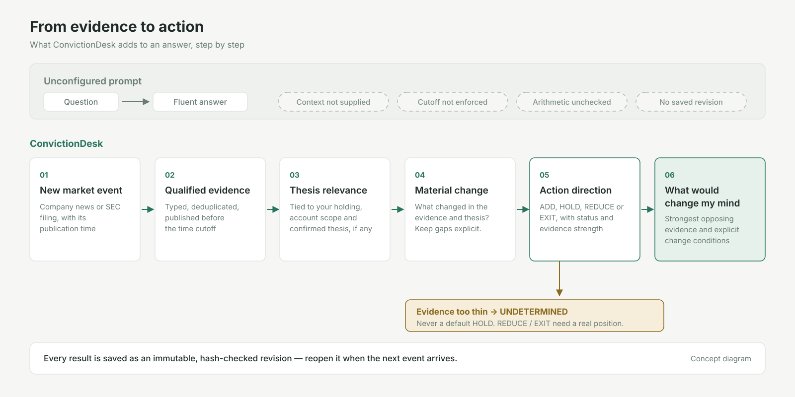

<h1 align="center">ConvictionDesk</h1>

<p align="center">
  <strong>Evidence-grounded US equity research and decision agent</strong><br>
  From market evidence to a clear investment decision.
</p>

<p align="center">
  <a href="https://github.com/Ernesto12139/ConvictionDesk/actions/workflows/ci.yml"></a>
  
  
</p>

ConvictionDesk is a local research workbench for people who hold or follow US stocks.
Saved research retains its evidence and revision history. On manual refresh it screens changes for the
companies you own or track. Research checks evidence against a frozen position and,
when explicitly confirmed, your investment thesis, then proposes a conditional direction: **ADD**, **HOLD**,
**REDUCE** or **EXIT**. The answer includes the evidence, the strongest argument against
it, and what would make it change its mind.

Authoritative financial calculations use deterministic Python `Decimal`. Material research
claims cite dated evidence; citation validation does not prove investment correctness. When the evidence is too thin, the answer is **UNDETERMINED**. It never
falls back to a default HOLD.

<p align="center">
  <picture>
    <source media="(prefers-color-scheme: dark)" srcset="docs/assets/convictiondesk-evidence-to-action-dark.svg">
    
  </picture>
</p>

## What it does

| | |
|---|---|
| **Today** | Manually scans company news for the companies in your research universe, removes duplicates and stale items, screens what is material, and ranks it. If the scan cannot finish, it says **PARTIAL** and shows what it covered. |
| **Research** | Takes one event or one question, binds it to a frozen snapshot of your holdings and an account scope, and investigates with typed tools (portfolio, end-of-day price, company news, SEC filings and XBRL). |
| **Decision** | Returns a typed Action Decision: a direction, a status (`SUPPORTED`, `PROVISIONAL`, `UNDETERMINED`, `NOT_APPLICABLE`), evidence strength, a **thesis delta** (what this evidence changed about your reason to own), counterevidence and change conditions. |
| **Record** | Saves every result as an immutable, hash-checked revision. You can reopen it, compare rounds and trace each claim to its source. |

### What the workbench makes explicit

| Common risk in an unconfigured one-off prompt | ConvictionDesk safeguard |
|---|---|
| Doesn't know what you hold | Each task is bound to a frozen portfolio snapshot. HOLD, REDUCE and EXIT are only allowed when you actually hold the stock. |
| Mixes facts and opinion | Statements are typed as fact, user assertion, AI draft or unknown. They cite evidence IDs that must exist in the task. |
| Can quietly use later information | Each task has a point-in-time cutoff. Sources published after it are rejected before anything is saved. |
| Does arithmetic in the model | Portfolio and SEC quarter math use Python `Decimal`. Model output that introduces new numbers is rejected. |
| Always has an answer | An evidence-backed direction may be `PROVISIONAL`; lack of a basis remains unknown. Insufficient evidence is `UNDETERMINED`. |
| Is gone when the chat ends | Every result is a revision you can reopen and audit. |

## Architecture

<p align="center">
  <picture>
    <source media="(prefers-color-scheme: dark)" srcset="docs/assets/convictiondesk-architecture-dark.svg">
    
  </picture>
</p>

ConvictionDesk is one Python service (FastAPI, Pydantic v2, `httpx`, stdlib `sqlite3`)
with a dependency-free HTML/CSS/JS console. No agent framework, vector database or
message queue is involved. Models are used for bounded screening, research planning and synthesis. Research output
may cite only the evidence supplied by the typed tool pipeline. Dashed boxes in
the diagram are planned work, not features.

## Fast and Deep

<p align="center">
  <picture>
    <source media="(prefers-color-scheme: dark)" srcset="docs/assets/convictiondesk-fast-deep-dark.svg">
    
  </picture>
</p>

| | Fast | Deep |
|---|---|---|
| Typical question | "Does this news change anything?" | "Should I act before the next report?" |
| Evidence | Up to 8 qualified sources (12 KB) | Up to 18 qualified sources (24 KB) |
| Extra work | None | Names the most material evidence gap and runs one targeted news or SEC check; adds up to four SEC quarters |
| Model budget | ≤ 3,072 output tokens, 45 s | ≤ 8,192 output tokens, 90 s |
| Result | Same typed Action Decision | Same, plus whether the extra check found new evidence |

Deep looks further. It has **not** been shown to judge better than Fast. If its extra
check finds nothing, it reports `NO_NEW_EVIDENCE` instead of implying a gain.

## Evidence, time and records

- **Point in time.** Each task has a cutoff. Publication time, retrieval time, the
  financial period and the price session are kept as separate fields.
- **Freshness.** Today classifies publication freshness by the New York calendar date, not an inferred trading session. An older story is not shown as
  today's news.
- **Unknown stays unknown.** A missing price or quarter is shown as unknown, never as
  zero or as a guess.
- **Immutable history.** Revisions are hash-checked in SQLite. Schema upgrades keep
  the original bytes.

## Models and data providers

| Role | Provider | Configured by | Status |
|---|---|---|---|
| Fast / Deep research | OpenAI Responses, `gpt-6.1-sol` (server profiles `sol-fast`, `sol-deep`) | `OPENAI_API_KEY` | Verified scoped server profiles; model availability depends on your account |
| Company news (Today) | Finnhub | `FINNHUB_API_KEY` | Implemented |
| End-of-day prices | Massive | `MASSIVE_API_KEY` | Implemented; closing prices, not real-time quotes |
| Filings and XBRL | SEC EDGAR | `SEC_USER_AGENT` (your contact, as SEC requests) | Implemented |
| Other OpenAI-compatible models | e.g. DeepSeek | `LLM_PROVIDER`, `LLM_BASE_URL`, `LLM_API_KEY`, `LLM_MODEL` | Experimental: a single general research path **without** the Fast/Deep profiles |

An LLM key alone does not enable complete live research. Today requires company-news
access; qualified closing-price references require market-data access; SEC retrieval
requires a contact user-agent and reachable official endpoints. Missing providers
remain unknown or unavailable; they do not become synthetic facts.

Keys are read only from the server's environment. `.env` files are not loaded, and
keys are never entered in or returned to the browser. Each provider's terms apply to
your use. The packaged preview uses fictional data; live responses stay in local storage and remain subject to provider terms.

## Install

Requires Python 3.12 or newer.

**macOS / Linux**

```bash
git clone https://github.com/Ernesto12139/ConvictionDesk.git
cd ConvictionDesk
python3 -m venv .venv
source .venv/bin/activate
pip install .
```

**Windows (PowerShell)**

```powershell
git clone https://github.com/Ernesto12139/ConvictionDesk.git
cd ConvictionDesk
python -m venv .venv
.venv\Scripts\python.exe -m pip install .
```

## Your first research workflow

Set the keys in the same shell, then start the local service. On Windows use
`.venv\Scripts\python.exe` in place of `python` below (activation is optional).
Use an installed Python 3.12+ interpreter (`python --version`). macOS/Linux shell commands are documented and covered by the
Linux CI workflow; local verification was performed on Windows.

```bash
# macOS / Linux
export MIA_RUNTIME_MODE=OWNER
export OPENAI_MODEL=gpt-6.1-sol
export OPENAI_API_KEY=...        # Fast / Deep research
export FINNHUB_API_KEY=...       # Today news
export MASSIVE_API_KEY=...       # end-of-day prices
export SEC_USER_AGENT="Your Name you@example.com"
python -m uvicorn market_agent.main:app --host 127.0.0.1 --port 8000
```

```powershell
# Windows PowerShell
$env:MIA_RUNTIME_MODE = "OWNER"
$env:OPENAI_MODEL = "gpt-6.1-sol"
$env:OPENAI_API_KEY = "..."
$env:FINNHUB_API_KEY = "..."
$env:MASSIVE_API_KEY = "..."
$env:SEC_USER_AGENT = "Your Name you@example.com"
.venv\Scripts\python.exe -m uvicorn market_agent.main:app --host 127.0.0.1 --port 8000
```

Open [http://127.0.0.1:8000/](http://127.0.0.1:8000/), then:

1. **Add your portfolio** under *我的组合* (CSV import), or add tickers to your
   research universe as a watch list.
2. **Refresh Today.** A new scan first asks for cost confirmation, then may call your news provider and
   research model. Cancel sends no request; observing an existing scan only reads its status.
3. **Open one event** with **Fast** for a quick direction, or **Deep** when you are
   deciding before earnings. New research, follow-ups and Deep checks show a cost
   confirmation first.
4. **Read the decision** top-down: direction and status, why, the strongest
   counterevidence, and the conditions that would change it. Open **Evidence** for
   every source with its type and publication time.
5. **Come back later.** The result is saved as a revision under *研究记录*.

Data is stored in `data/market_agent.db` (set `MIA_DB_PATH` to move it). The local
service has no authentication, so keep it on `127.0.0.1`. The interface is currently
in Simplified Chinese.

## Offline preview, no keys

To look around before configuring anything, run the keyless synthetic replay. It makes
no model or market-data calls, ignores any keys in the environment and refuses every
write. All companies (XMPL, XGRD), headlines, filings, prices and accounts are
fictional, and the judgments are scripted text that demonstrates the pipeline, not
model reasoning quality.

```bash
MIA_RUNTIME_MODE=PUBLIC_DEMO python -m market_agent.serve
# open http://127.0.0.1:8080/
```

After Local Research in PowerShell, set `$env:MIA_RUNTIME_MODE = "PUBLIC_DEMO"`
and run `.venv\Scripts\python.exe -m market_agent.serve` (port 8080). A fresh
shell also defaults this entrypoint to preview mode. Use a new `MIA_DEMO_DIR` if
a previous dataset version is refused; preserve old directories.

Docker runs the same preview:
`docker build -t convictiondesk . && docker run -p 127.0.0.1:8080:8080 convictiondesk`.

<details>
<summary>For contributors: run the tests</summary>

```bash
pip install ".[test]"
python -m pytest -q
python scripts/smoke_public_demo.py --base http://127.0.0.1:8080
```

</details>

## Status and limitations

**Verified** below refers to the scoped deterministic contracts and synthetic
journeys, not universal live coverage, investment quality or Owner acceptance.
Public CI and release status are reported separately by GitHub. **Experimental** means implemented but not verified on live data by the public
release.

| Status | Capability |
|---|---|
| Verified | Typed ADD / HOLD / REDUCE / EXIT decision with status, evidence strength, thesis delta, counterevidence and change conditions; holding applicability |
| Verified | Fast / Deep budgets, context limits and tool permissions |
| Verified | Evidence-ID and point-in-time validation: invalid citations and later sources are rejected |
| Verified | SEC quarter / YTD normalization in `Decimal`, derived Q4, up to four quarters |
| Verified | Today states: complete, no material events, partial, provider unavailable |
| Verified | Keyless synthetic preview: Today → Fast / Deep → Action Decision, zero model and data calls |
| Experimental | Live Today scans, live research and portfolio import with your own keys |
| Experimental | Quality of materiality screening and of the direction. **No accuracy or return claim.** |
| Planned | Live market cap, EV and multiples; cash-flow valuation and Bull / Base / Bear scenarios |
| Planned | 13F institutional holdings, Form 4 insider transactions |
| Planned | Cross-provider bring-your-own-key with Fast / Deep profiles |
| Planned | English and Traditional Chinese interface |

Known limits:

- Prices are end-of-day closes, not real-time quotes.
- A Today scan of a full watch list is not yet shown to complete reliably. Large
  universes can end as PARTIAL under provider limits.
  - Research quality has not been benchmarked against general-purpose assistants.
- No broker integration and no trade execution.

**ConvictionDesk is a research tool, not investment advice.**

## Releases

This repository is an independently initialized source release, with no inherited Git history. Development happens in a private engineering
repository, and each release is an allowlisted export of one verified upstream commit,
recorded in [`release/RELEASE_MANIFEST.json`](release/RELEASE_MANIFEST.json).
This project uses AI-assisted development; public Git commits and releases are
maintained under the repository owner's identity. Issues and
suggestions are welcome; code changes are applied upstream and arrive in the next
release.

| Version | Highlights |
|---|---|
| v0.8.1 | Saved research opens completely; execution details move behind *执行记录与诊断*; README and diagrams |

## License

[MIT](LICENSE) © 2026 Ernesto12139. The license covers this repository's code.
Dependencies are installed from PyPI under their own licenses (FastAPI, Pydantic,
Starlette, Uvicorn, HTTPX, tzdata and their dependencies), and none are vendored.
External data providers remain governed by their own terms. The diagrams in
`docs/assets/` are original to this project and are covered by the same license.
