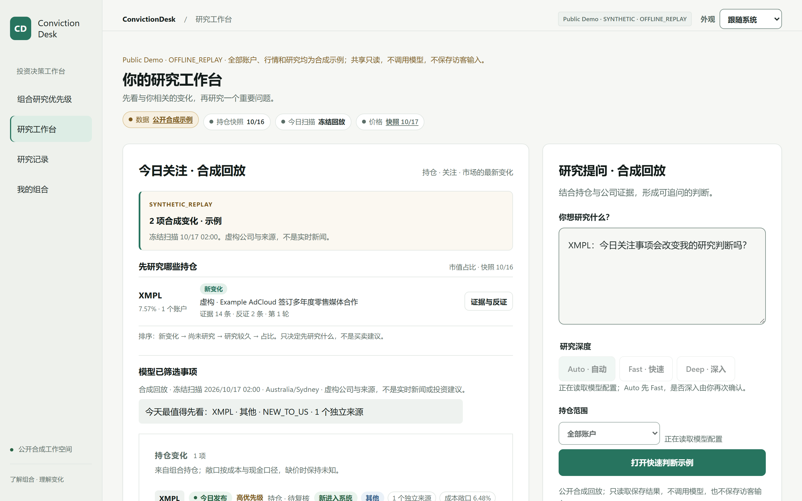
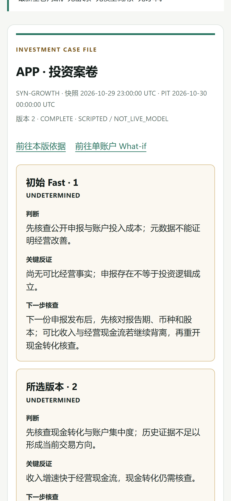
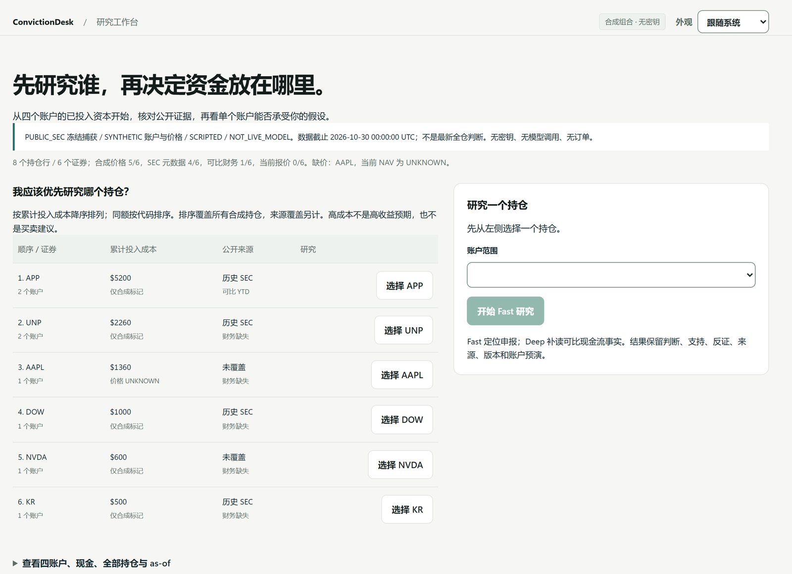
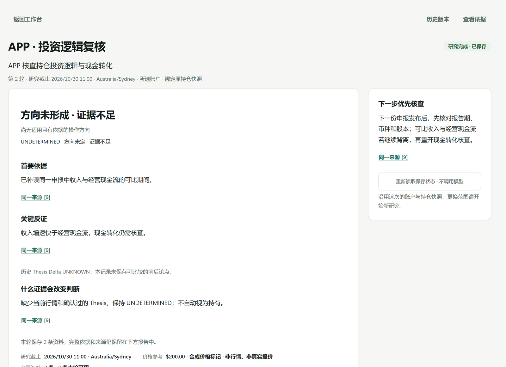
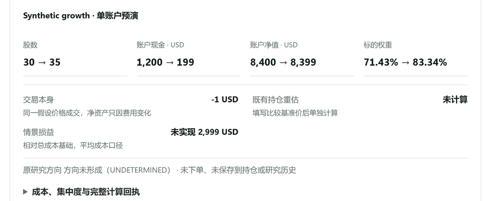
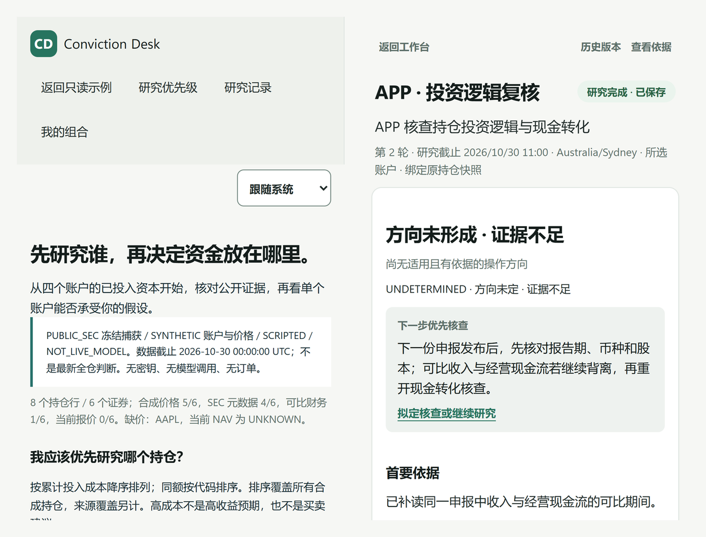

# Showcase

## Investor-first workbench

The home leads with today's scan state, your holdings in research order and the
research question box. Each status chip links to its detail; full provenance and
runtime records sit below the work. This capture is the read-only replay scope
(synthetic accounts, scripted research).

The Investment Case File after APP Fast and same-task Deep, on a 390-pixel phone.
Both rounds stay readable and both remain `UNDETERMINED`.

## v0.12.0 screens

Screens from ConvictionDesk v0.12.0, captured from the default keyless workbench
(`python -m market_agent.serve`, then **组合研究优先级**) at 1440 and 390 pixels with
every external request blocked. SEC filing metadata and financial facts are real,
frozen public captures (`PUBLIC_SEC`). The four accounts, their cash and marks are
invented (`SYNTHETIC`). The research prose is a fixed script (`SCRIPTED`). The
interface is in Simplified Chinese.

## Where to look first

Six synthetic holdings across four accounts, ranked by committed cost (shares ×
average cost). Source coverage sits beside the rank and does not change it. No
holding has a current quote, so current NAV is `UNKNOWN`.

## One record, two rounds

APP in the Synthetic growth account: Fast locates the filings, then Deep adds
comparable January–June revenue and operating cash flow from the same 10-Q as
round 2. Python `Decimal` derives +55.77% and +34.70%. Revenue outgrew cash flow,
there is no confirmed prior thesis and no current price, so the judgment stays
`UNDETERMINED`; it is not turned into HOLD. Round 1 is kept exactly as saved.

<picture>
  <source media="(prefers-color-scheme: dark)" srcset="assets/convictiondesk-v012-record-dark.png">
  
</picture>

## Account What-if

Five more APP shares at a hypothetical USD 200 with a USD 1 fee: cash 1,200 → 199,
shares 30 → 35, account value 8,400 → 8,399. The trade itself only costs the fee.
Seven shares would be refused, because one account cannot spend another account's
cash. Nothing is ordered or saved.

<picture>
  <source media="(prefers-color-scheme: dark)" srcset="assets/convictiondesk-v012-whatif-dark.png">
  
</picture>

## On a phone

## How these images were made

Each screen is a direct headless-Chromium capture of the released v0.12.0 source
(`a251e90`) served on loopback, at 1440 × 900 and 390 × 844, with every request to
another origin aborted (none were made). Images are cropped and scaled, and the
two phone screens are placed side by side; nothing is retouched. On-screen times
use the capturing browser's local time zone; saved receipts keep UTC. Provenance:
[`release/ASSET_PROVENANCE.md`](../release/ASSET_PROVENANCE.md).

Earlier screens remain in [`assets/`](assets/): the v0.10.0 filing-first workbench
(`convictiondesk-v010-*`) and the v0.9 replay (`convictiondesk-journey-*`,
`-records-*`).
