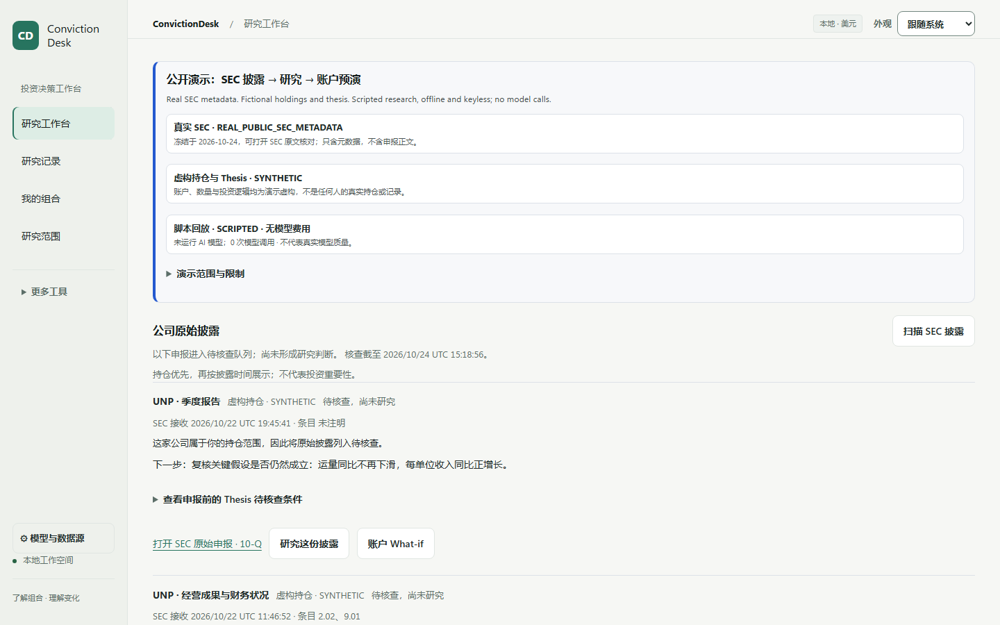
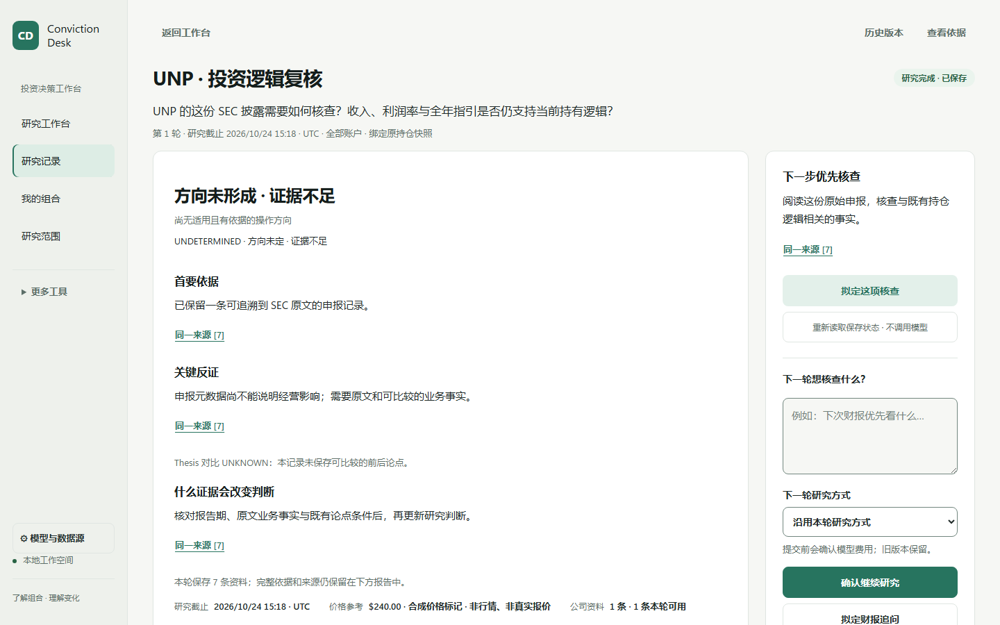
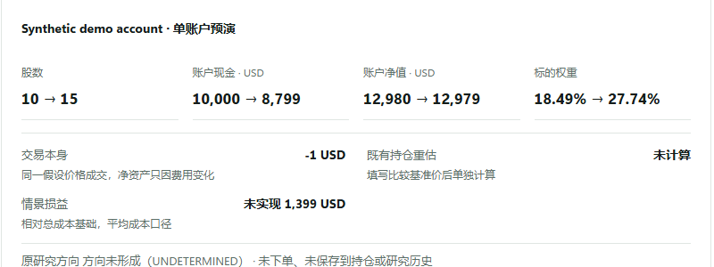
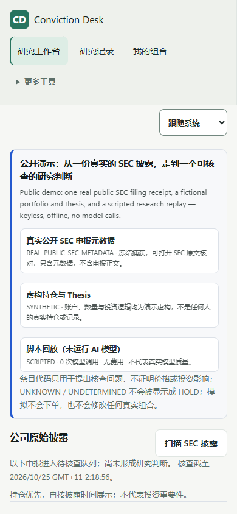

# Showcase

Screens from ConvictionDesk v0.10.0, captured from the keyless workbench
(`python -m market_agent.public_ivs --serve`) at 1440 and 390 pixels. SEC filing
metadata is real; the account, thesis and prices are synthetic; research text is
scripted. The interface is in Simplified Chinese.

## The filings that matter to you

The workbench opens on recent SEC filings for the demo holdings (UNP, KR) and
watch list (DOW). The banner names the three kinds of data on the page. Each card
gives the form, the SEC acceptance time, why the filing is here and what to check
first, with a link to the original and the thesis held before it.

## A research record

Researching the UNP 8-K returns the direction (here not formed, because the
filing metadata alone does not establish an operating impact), the primary
evidence, the strongest counterevidence, what would change the judgment and the
next check. The record keeps its cutoff and round number, and Deep continues it as
round 2.

## Account What-if

From the result, preview a hypothetical trade. Shares, cash, NAV and weight are
computed before and after in `Decimal`; the trade itself and repricing of shares
already held are reported separately. Nothing is ordered or saved.

<picture>
  <source media="(prefers-color-scheme: dark)" srcset="assets/convictiondesk-v010-whatif-dark.png">
  
</picture>

## On a phone

## How these images were made

Each screen is a direct headless-Chromium capture of the v0.10.0 workbench; the
What-if is cropped, nothing is retouched, and files carry no image metadata. The
README hero frames one of these captures with an original receipt rail, and the
flow diagram is an original SVG; both are generated from
[`assets/src/`](assets/src/). Provenance:
[`release/ASSET_PROVENANCE.md`](../release/ASSET_PROVENANCE.md).
